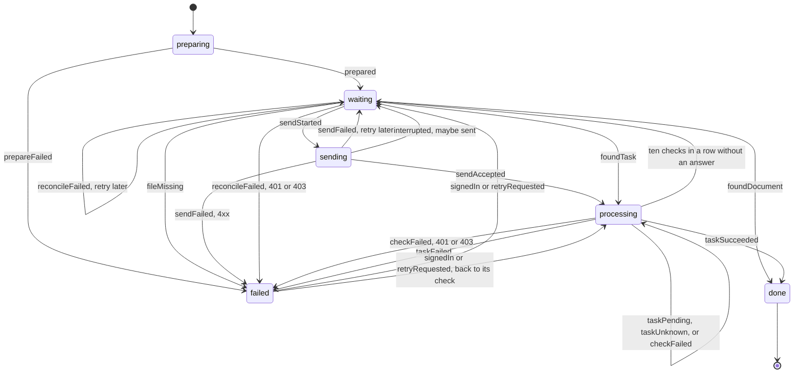

# Waraq

An Android app for scanning paper documents into your own Paperless-ngx server. Waraq is a working name.

Waraq needs Paperless-ngx 3.0 or newer. It talks to the REST API at version 10.

## Code layout

- `src/paperless/` is the API client. It uses the `fetch` it is given, and parses every response with Zod before the rest of the app sees it. Zod is the one dependency added for that.
- `src/upload/` holds the upload job. Each scanned document becomes one job, and a table in `machine.ts` lists every state change the job allows. `runStep` in `runner.ts` is the only code in that folder that talks to the server or the disk.
- `src/brand.json` holds the app name, slug, and Android package. Change them there.

## How an upload moves



The file goes up as `<job id>.pdf`. Paperless-ngx accepts the same file twice, so the app never sends a file again just because it is unsure. If a send may have reached the server, for example after a timeout or an app crash, the job looks for a consume task with that file name first, whatever the task's status, and then for a document. When it finds neither inside two minutes of the send's start, it looks again thirty seconds later, because the server may still be working on the request. It sends again only when nothing has turned up after that.

A 401 stops the job at `sign_in_required` and a 403 at `not_permitted`. Both remember the step they stopped at (the send, the lookup, or the check of a task) and continue from there once the user signs in or asks for a retry, so a file the server may already have is never sent again blindly.

Three rules keep two copies of a job from sending the same file:

- `JobStore.saveIfUnchanged` writes only when the stored row still has the `updatedAt` the caller loaded, and returns whether it wrote. A row that is gone counts as changed, so a job the user deleted never comes back. A new job goes in through `insert`. `runStep` claims a job as `sending` with that check before it sends anything. A `runStep` that returns the job it was given either had nothing due or lost that claim. Reload the job before trying again. `deleteIfUnchanged` makes the same check, so a stale copy cannot delete a job that a runner has since claimed.
- One drain runs at a time per JavaScript runtime.
- `recoverAfterRestart` runs once when the process starts, before any drain. It never runs from a background entry point while the process is alive, because a job found in `sending` then is being sent, not left behind.

## Run the tests

You need Bun and Docker.

1. Install the dependencies.

   ```sh
   bun install
   ```

2. Run the type check and the unit tests. They need no network.

   ```sh
   bun run typecheck
   bun run test
   ```

3. Start the throwaway Paperless-ngx on port 8011. It runs apart from the dev server on port 8010, so the tests never touch the dev data.

   ```sh
   dev/test-server.sh up
   ```

4. Run the integration tests against it.

   ```sh
   bun run test:integration
   ```

5. When you are done, remove the server and its data.

   ```sh
   dev/test-server.sh down
   ```

To test another Paperless-ngx release, set `PAPERLESS_VERSION` when you start the server, for example `PAPERLESS_VERSION=3.0.0 dev/test-server.sh up`. Run `down` first, because the stored data belongs to the release that made it. To point the tests at a different server, set `PAPERLESS_TEST_URL`. The tests sign in as `admin` with the password from `dev/compose.yaml`.
