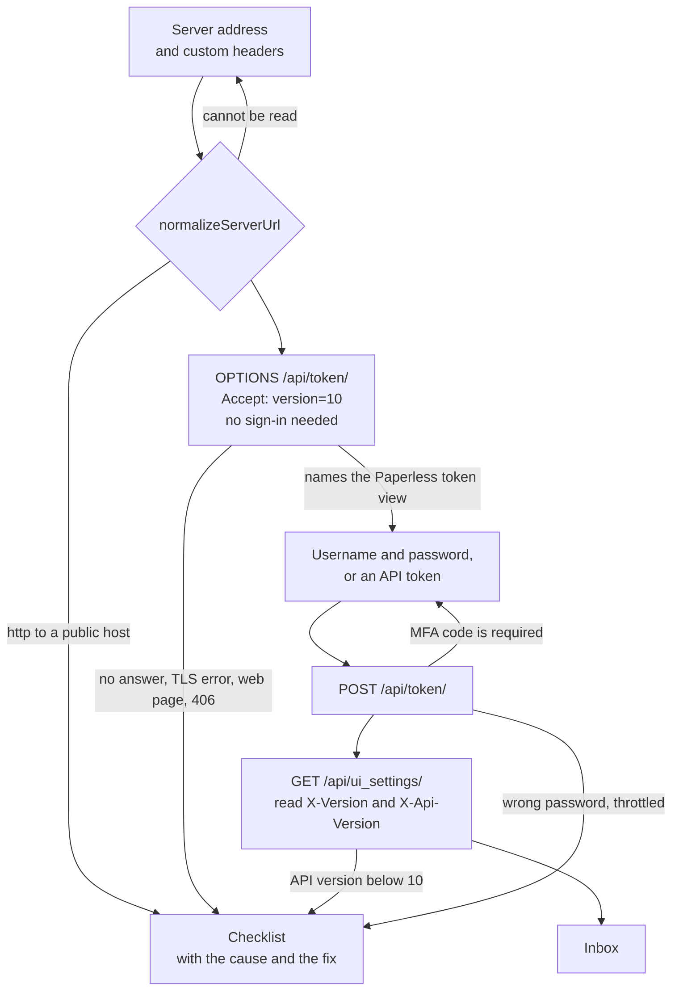
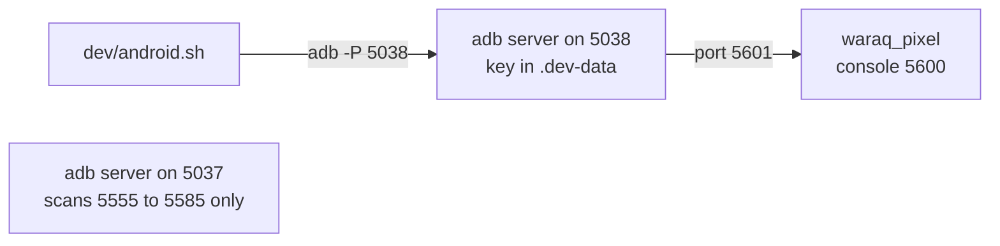
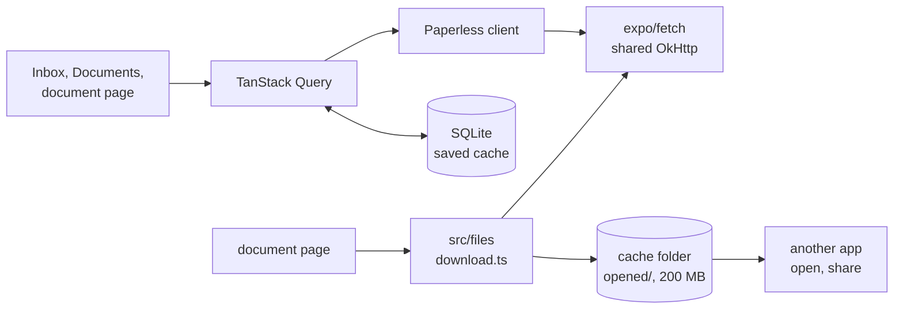
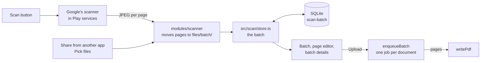
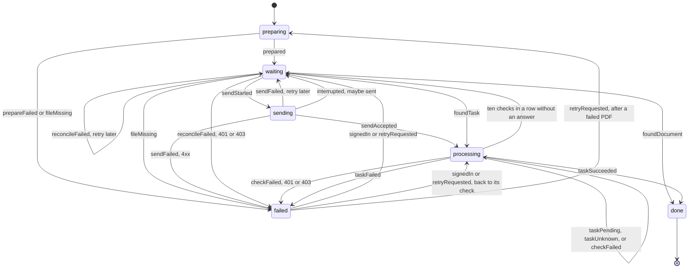
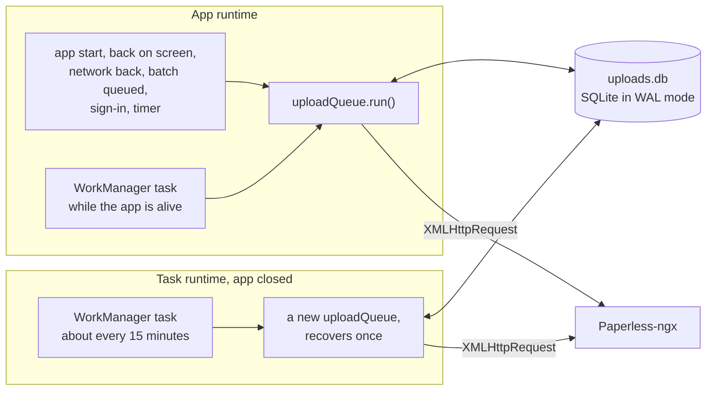

# Waraq

An Android app for scanning paper documents into your own Paperless-ngx server. Waraq is a working name.

Waraq needs Paperless-ngx 3.0 or newer. It talks to the REST API at version 10.

## Code layout

- `app/` holds the screens, one file per route, for expo-router. `(tabs)/` is Inbox, Documents, and Uploads. `sign-in/` is shown only while no account is stored.
- `src/paperless/` is the API client. It uses the `fetch` it is given, and parses every response with Zod before the rest of the app sees it. Zod is the one dependency added for that.
- `src/signin/` holds the sign-in steps and the checklist that a failed sign-in shows. It is plain TypeScript, so the tests run it in Node.
- `src/account/` stores the one account. The address, user, and server version go in SQLite. The token and the custom header values go in the Android Keystore through expo-secure-store. The account's id is a hash of the server address and the username, so signing in again to the same server as the same user gives the same id, and the uploads held for that account carry on.
- `src/documents/` turns the filter sheet and the server's saved views into list parameters, and works out which fields an edit changed. `src/inbox/` groups the inbox and removes a row when it is marked done. Both are plain TypeScript.
- `src/cache/` names every TanStack Query key and saves the cache to SQLite. `src/files/` keeps opened documents in the cache folder.
- `modules/scanner/` is a local Expo module in Kotlin. It opens Google's document scanner, writes PDFs, and brings in files picked on the phone or shared from other apps. It imports nothing from Waraq, so it can move into a package of its own.
- `src/scan/` holds the batch being scanned. `batch.ts` has the data shapes and every edit as a plain function. `store.ts` keeps the batch in SQLite and its files in the app's files folder.
- `src/upload/` holds the upload queue. Each scanned document becomes one job, and a table in `machine.ts` lists every state change the job allows. `runStep` in `runner.ts` takes one job one step. `store.ts` keeps the jobs in SQLite, `drain.ts` runs every job that is due, and `rows.ts` works out what the Uploads screen shows. These files are plain TypeScript, so the tests run them in Node. `queue.ts` connects them to the phone's database, files, account, and network, and `background.ts` runs the queue while the app is closed.
- `src/copy.ts` holds every word the app shows. Screens take their text from it.
- `plugins/network-security.ts` writes Android's network security config. It trusts certificate authorities that the user installed, and allows plain HTTP, which `normalizeServerUrl` then allows only for addresses on a home network or VPN.
- `src/brand.json` holds the app name, slug, and Android package. Change them there.

Four libraries came in with the document screens. `@tanstack/react-query-persist-client` saves the query cache. `@react-native-community/datetimepicker` opens Android's date dialog. `expo-file-system` writes downloaded files and hands them to the phone's PDF app. `expo-sharing` opens the share sheet. None of them adds an Android permission.

The scanner module adds one library, Google's `play-services-mlkit-document-scanner`. The scanner itself runs inside Play services, so the app gets no camera permission. Its checks on the emulator use `androidx.test`, which goes only into the test APK.

Two libraries came in with the upload queue. `expo-background-task` asks Android's WorkManager to run the queue while the app is closed. `expo-task-manager` holds the code that WorkManager runs, under a task name.

## How sign-in works



Paperless-ngx sends its version headers only to a signed-in user, so the first check needs another signal. `OPTIONS /api/token/` needs no sign-in, and Paperless-ngx 3.x answers it with JSON that names its token view, "Paperless Obtain Auth Token". A server that cannot speak API version 10 answers 406. The version is read after sign-in. The probe counts against the same limit as the token request, five a minute.

## Build for Android

`dev/android.sh` builds a release APK signed with the debug key and runs it on a headless emulator of its own, `waraq_pixel`. It reads `JAVA_HOME` and `ANDROID_HOME` from the environment or from `.dev-data/toolchain.env`, which git does not track:

```sh
export JAVA_HOME=/path/to/jdk-17
export ANDROID_HOME=/path/to/android-sdk
```

Expo SDK 58 compiles against Android API 37, so the SDK needs `platforms;android-37.0` and `build-tools;37.0.0`. The app targets API 36.

The emulator talks only to an adb server of its own on port 5038. Its console and adb ports, 5600 and 5601, sit above 5585, the last port that adb servers scan for emulators. Another project's adb server on the default port 5037 never sees it, even when that server runs with a different key.



```sh
dev/android.sh build       # the APK, then its package, SDK levels, and permissions
dev/android.sh boot
dev/android.sh install
dev/android.sh shot inbox  # .dev-data/shots/inbox.png
dev/android.sh flow        # the documents flow against http://10.0.2.2:8010, described below
dev/android.sh upload      # the upload flow against the same server, described below
dev/android.sh scan        # the scan flow, described below
dev/android.sh pdf-check   # the PDF writer's checks on the emulator, then its 10-page PDF opened on the Mac
dev/android.sh logs
dev/android.sh adb devices # any adb command, against port 5038
dev/android.sh stop        # this emulator and its adb server only
```

The APK asks for `INTERNET`, `ACCESS_NETWORK_STATE`, `ACCESS_WIFI_STATE`, `VIBRATE`, `WAKE_LOCK`, and `RECEIVE_BOOT_COMPLETED`. The last two came with the upload queue's background task: WorkManager holds the CPU awake while the task runs, and reschedules the task after a reboot. WorkManager also declares `FOREGROUND_SERVICE` for a foreground service the task never uses, so `app.config.ts` blocks that one. No camera, storage, or media permission.

`dev/android.sh flow` signs in to the dev server on port 8010. It searches for "hydro", opens the September bill, adds " 2026" to its title, and saves. Then it marks the interest slip done in the inbox and taps Undo. It takes a screenshot at each step, then shows the key screens again in dark mode and at font scale 1.3. Before and after the light run, it puts the title and the inbox tag back through the API. It also adds the saved views Bills, School, and Tax if they are missing.

`dev/android.sh upload` scans three documents, one of them with two pages, gives them the Bills tag, uploads them, and waits until the Uploads tab says Done for all three. Then it queues one more and kills the app while the send is still running, to see the job look for its upload instead of sending it twice. The emulator's network shaping leaves traffic to the host alone, so the flow signs in through `dev/slow-proxy.py`, which passes every request to the dev server and reads an upload body at 1 KB a second. Then it turns the network off, queues one more, kills the app, turns the network on, and runs the WorkManager job by hand, to see the document arrive with no screen open. After each part it asks the dev server how many documents named `<job id>.pdf` it holds. At the end it deletes every document the flow uploaded, so the seeded data stays as it was.

`dev/android.sh scan` drives Google's scanner through the emulator's virtual camera. The emulator boots with `-camera-back virtualscene` and hangs the lease renewal fixture, `dev/fixtures/pdf/lease-renewal.png`, on the wall of the virtual room. The script turns the camera toward the poster or a blank wall through the emulator's gRPC `setPhysicalModel` call, so it needs `grpcurl`. Set `GRPCURL` to its path, here or in `.dev-data/toolchain.env`. The flow scans two pages as document one and one page as document two. It rotates a page, splits document one, sets the tag Bills for every document, and stops at the Upload button. Then it opens the saved batch again in dark mode and at font scale 1.3. Last, it shares a PDF into Waraq with `adb shell am start -a android.intent.action.SEND`.

## How the document screens get their data

Every list and detail goes through TanStack Query. The app saves its cache to SQLite through `expo-sqlite/kv-store` a second after each change. On the next start, the Inbox, Documents, and any document opened before show at once. While the phone has no network, they say "Offline, showing saved copy". Suggestions, search results, and the counts in the filter sheet are not saved. The cache is dropped on sign-out.



- **Filters and saved views.** `documentQuery` turns the search text, the filter sheet, and the sort into query parameters. A saved view's rules become parameters through the same rule table that the Paperless-ngx web app uses. The filter sheet and the sort win where both set one.
- **Edits.** The edit page sends `PATCH /api/documents/<id>/` with only the fields that differ from the document as it was opened. Dates are `YYYY-MM-DD` strings. The date picker runs in UTC, so a picked day is stored as that day in every time zone.
- **Done in the inbox.** Done sends one `PATCH` with the document's tags minus the inbox tags. The row leaves the list at once and comes back where it was if the request fails or the user taps Undo.
- **Opening a file.** The app downloads the file through the same `expo/fetch` as every other request and writes the body to the cache folder chunk by chunk, so a 20 MB PDF never sits whole in memory. Android then hands the file to the user's PDF app, or to the share sheet. Opened files stay in `opened/` up to 200 MB. Past that, the oldest go first.
- **Missing permissions.** A label list, the notes, or the saved views that answer 403 hide their part of the screen. The rest keeps working.

## How a scan becomes a batch



- **No camera permission.** Google's scanner runs in Play services and hands back one JPEG per page. The module moves each page out of the scanner's cache folder into `files/batch/` at once, so Android cannot clear it.
- **Nothing is lost.** The batch is saved to SQLite after every change. A killed app keeps it, and the Scan button offers to continue it. A file leaves `files/batch/` only when the user deletes its page, discards its document or batch, or signs out. After Upload, the upload job owns the files and deletes them.
- **Edits are plain functions.** Adding pages, rotating, moving, deleting, retaking, and splitting each take a batch and return a new one. `filesLeftBehind` compares the batch before and after an edit and names the files to delete.
- **Files from other apps.** Waraq takes `ACTION_SEND` and `ACTION_SEND_MULTIPLE` for `application/pdf` and `image/*`, and Pick files opens Android's own file picker. Neither needs a permission. A shared or picked PDF becomes one document as it is. Pictures become the pages of one new document.
- **How a document reaches its upload job.** A document of `kind: 'pages'` carries its page list, and the job builds `<id>.pdf` with `writePdf(pages, outputUri)`. A document of `kind: 'pdf'` carries a ready PDF at `pdf.uri`, and the job sends that file as it is.

`writePdf` places each page's JPEG bytes in the PDF as the scanner made them, without decoding them, and turns a page with the PDF's own `/Rotate`. Only a page above 400 dots per inch, a picture that is not a JPEG, or a CMYK JPEG is decoded once and saved again as a JPEG at quality 85. A page is A4 or Letter when the scan has that shape, within 4 percent. Any other scan, such as a receipt, gets the width of A4 and the height that its shape needs. The writer streams to disk and holds at most one page in memory.

| 10 pages of 300 dpi A4 with paper grain | PDF size | Native memory while writing |
|---|---|---|
| Android's `PdfDocument`, tried first | 99.9 MB | grew by 348 MB, and by 1089 MB for 30 pages |
| `writePdf`, the JPEGs as they are | 25.3 MB, the JPEGs plus about 500 bytes a page | no growth |

`PdfDocument` keeps every page's bitmap until it writes the file and stores them without loss, which is why it was dropped. A scanned document weighs what its JPEGs weigh, and the scanner sets that. It has not been measured on a phone yet.

## How an upload moves



The file goes up as `<job id>.pdf`. Paperless-ngx accepts the same file twice, so the app never sends a file again just because it is unsure. If a send may have reached the server, for example after a timeout or an app crash, the job looks for a consume task with that file name first, whatever the task's status, and then for a document. When it finds neither inside two minutes of the moment it became unsure, which is when the send failed or when the app found the job left in `sending` after a restart, it looks again thirty seconds later, because the server may still be working on the request. It sends again only when nothing has turned up after that, and then after the usual retry delay for its attempt, so a loop of kills cannot resend without a pause.

A 401 stops the job at `sign_in_required` and a 403 at `not_permitted`. Both remember the step they stopped at (the send, the lookup, or the check of a task) and continue from there once the user signs in or asks for a retry, so a file the server may already have is never sent again blindly.

Three rules keep two copies of a job from sending the same file:

- `JobStore.saveIfUnchanged` writes only when the stored row still has the `updatedAt` the caller loaded, and returns whether it wrote. A row that is gone counts as changed, so a job the user deleted never comes back. A new job goes in through `insert`. `runStep` claims a job as `sending` with that check before it sends anything. A `runStep` that returns the job it was given either had nothing due or lost that claim. Reload the job before trying again. `deleteIfUnchanged` makes the same check, so a stale copy cannot delete a job that a runner has since claimed.
- One drain runs at a time per JavaScript runtime.
- `recoverAfterRestart` runs once when the process starts, before any drain. It never runs from a background entry point while the process is alive, because a job found in `sending` then is being sent, not left behind.

Files move from the batch to the queue in two steps. Upload inserts one job per document, then clears the batch, which lives in another SQLite file. A batch found with jobs already made for some of its documents lost that second step, so those documents leave the batch when it is loaded and their files belong to their jobs. A document's page files stay on disk until its PDF exists, so a PDF that failed for want of space can be built again from them with Retry. They go when the PDF is built, when one of them turns out to be missing, or when the user deletes the job. The first page stays, so the Uploads screen can show it. The first page, the PDF, and a shared PDF's thumbnail go when the job is done. A step that throws is reported, that job is left alone for the rest of the run, and the queue tries it again a minute later. While the phone is offline, no job takes a step, because a send that never left the phone must not count as maybe sent. The network coming back starts the queue.

One known gap remains. If the user retries a job that Paperless could not consume, and that retry's request never reaches the server, the lookup finds the earlier failed task with the same file name and shows that failure again. Nothing is uploaded twice. The user sees the old error and can retry once more.

### Where the jobs live

Each job is one row of the table `upload_jobs` in the SQLite file `uploads.db`. The state, the upload fields, and the input pages are JSON columns that Zod parses on read. A row that does not parse shows on the Uploads screen as failed, with Delete and no Retry. The store never drops it.

Each store rule is one SQL statement, so it holds between two JavaScript runtimes that share the file:

- `insert` is `INSERT OR IGNORE`. It counts as written only when one row changed, so a batch queued twice makes each job once.
- `saveIfUnchanged` is `UPDATE ... WHERE id = ? AND updated_at = ?`.
- `deleteIfUnchanged` is `DELETE ... WHERE id = ? AND updated_at = ?`.

The database runs in WAL mode and waits up to five seconds for a lock.

### When the queue runs

`drain.ts` runs the queue. A run loops `runStep` over every job that is due, until a pass changes nothing. It skips the jobs of an account that is not signed in, so those never send. At the end it sets one timer for the earliest retry or task check, at most 30 minutes ahead. A call while a run is going makes that run do one more pass. It never starts a second drain.

These start a run:

- the app starts with an account signed in
- the app comes back to the screen
- the network comes back
- a batch is queued
- the user signs in, which first moves the jobs of that account held at `sign_in_required`
- the timer for the next retry or check
- Android's WorkManager, about every 15 minutes while the app is closed

When a run throws an error, `queue.ts` logs it and starts another run a minute later.



`background.ts` defines the WorkManager task at module scope, as `expo-task-manager` asks. `index.ts`, the app's entry file, imports it before `expo-router/entry`, because Android starts the app with no screens to run the task, and expo-router loads a route file only when it renders. The task calls `run()` on the same queue object as the screens. `queue.ts` makes that object once per JavaScript runtime, and only its first run calls `recoverAfterRestart`. When WorkManager runs the task while the app is alive, the task runs in the app's runtime. That queue has already recovered, so it leaves a job in `sending` alone, because the app is sending it. When the app is closed, Android starts a new runtime with no screens. Its queue is new and recovers once. Nothing else in that process sends, so a job found in `sending` there was left behind. The test "recovers a job left in sending once per queue, and a new queue recovers again" in `drain.test.ts` checks both cases.

### Files

The queue writes the PDF to `uploads/<job id>.pdf` in the app's documents folder. A job that arrives as a ready PDF, shared from another app, skips that step. When a job leaves `preparing`, the queue deletes its page files except the first, whether the PDF was made or not. It deletes the first page and the PDF when the job is done. A done job's row stays a week as history, then a run deletes it with `deleteIfUnchanged`. Delete on the Uploads screen removes the row and every file of the job.

### The upload request

The upload goes through React Native's `XMLHttpRequest`, not `expo/fetch`. `expo/fetch` reports no upload progress, and it reads a `FormData` body whole into memory, so a 20 MB PDF would sit in memory twice. `XMLHttpRequest` streams the file part from disk and reports how much it has sent. Both build their HTTP client with `OkHttpClientProvider.createClient`, so the network security config and the user's certificate authorities apply to both. The Paperless client sets the account's headers on each request either way. `xhrFetch.ts` passes progress on only when 250 milliseconds have gone by since the last report or the share sent has grown by one percent, so the Uploads screen does not redraw for every chunk.

## Run the tests

You need Bun and Docker.

1. Install the dependencies.

   ```sh
   bun install
   ```

2. Run the type check and the unit tests. They need no network.

   ```sh
   bun run typecheck
   bun run test
   ```

3. Start the throwaway Paperless-ngx on port 8011. It runs apart from the dev server on port 8010, so the tests never touch the dev data.

   ```sh
   dev/test-server.sh up
   ```

4. Run the integration tests against it.

   ```sh
   bun run test:integration
   ```

5. When you are done, remove the server and its data.

   ```sh
   dev/test-server.sh down
   ```

To test another Paperless-ngx release, set `PAPERLESS_VERSION` when you start the server, for example `PAPERLESS_VERSION=3.0.0 dev/test-server.sh up`. Run `down` first, because the stored data belongs to the release that made it. To point the tests at a different server, set `PAPERLESS_TEST_URL`. The tests sign in as `admin` with the password from `dev/compose.yaml`.
