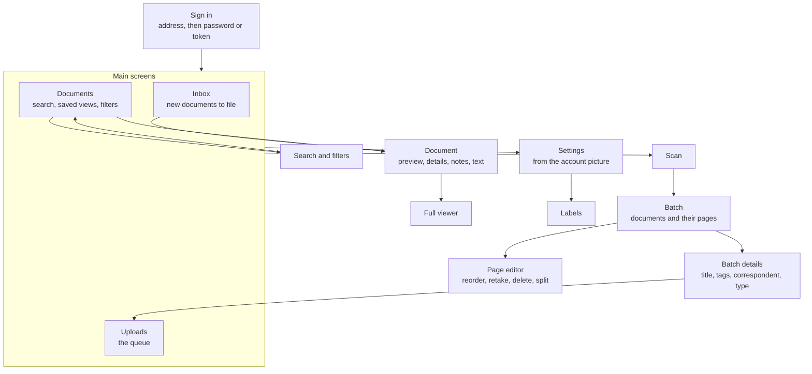
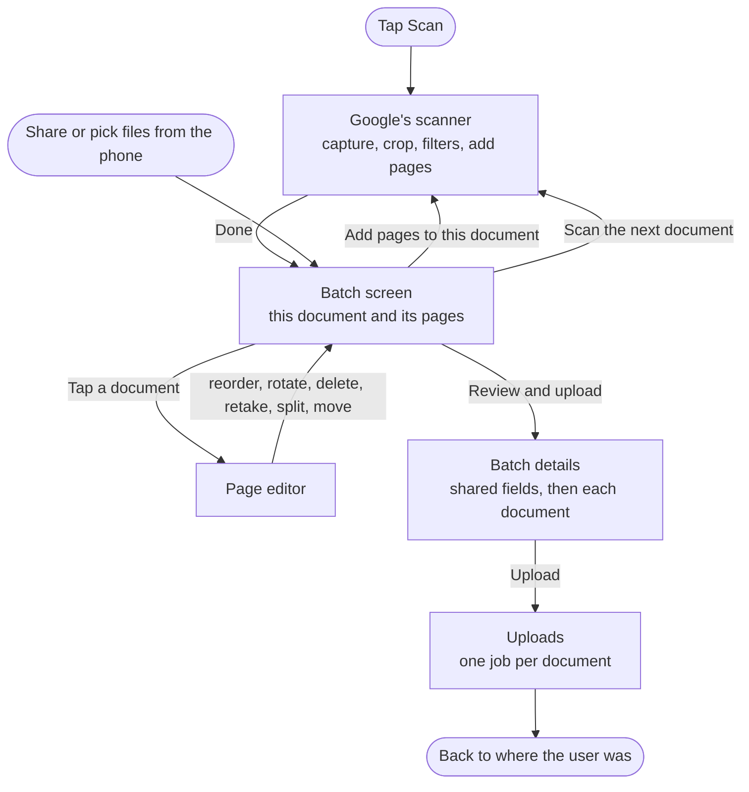
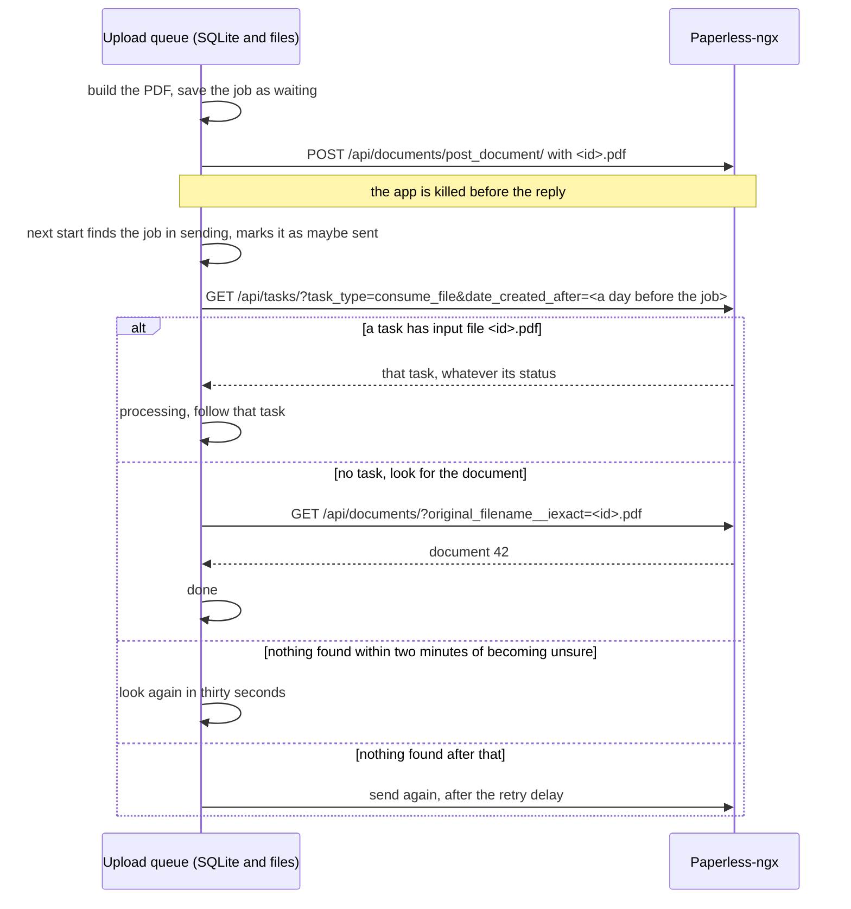
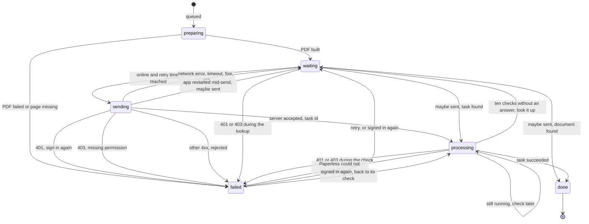
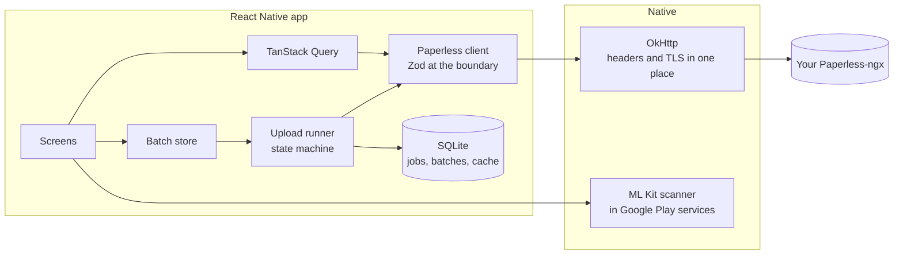

# Waraq design proposal

Waraq is an Android app for people who run their own Paperless-ngx server. It lets them read, find, and tidy their documents, and it scans paper with Google's document scanner and files it on their server. Waraq (ورق) is Arabic for paper. The name is a working name.

This page records the design, written before any screen was built.

## Why this app, and why now

The reference app, paperless-mobile, has 100K+ installs on Google Play. It does not work with Paperless-ngx 3.x. Paperless-ngx 3.0 shipped on 2026-07-22 with API version 10, and on 2026-08-02 the maintainer wrote that the app "is only compatible with API v9" ([issue 671](https://github.com/astubenbord/paperless-mobile/issues/671#issuecomment-5159661427)). No fix has shipped since. Users opened 26 issues about it, and Play reviews now call it abandoned.

paperless-mobile is licensed GPL-3.0. Waraq takes only its feature list as a reference and contains none of its code.

## Decisions at a glance

| Question | Proposal |
|---|---|
| Servers | Paperless-ngx 3.0 and newer. The app asks for API version 10. |
| Sign-in | Username and password, with the MFA code on the same screen. An API token as the other path. |
| Reaching the server | HTTPS, HTTP on a home network or VPN, a private CA installed in Android, and custom headers for proxies. Client certificates come later. |
| Layout | Two directions in the mockups. Both have fewer places than paperless-mobile. |
| Scan | Google's ML Kit document scanner, the one Daftar proved. One batch holds several documents. Each document holds several pages. |
| Upload | One job per document, kept on disk. It survives a killed app and an offline phone, and the app never uploads the same document twice. |
| Stack | Expo SDK 58, React Native 0.88, TypeScript, TanStack Query, expo-sqlite, Zod. |
| Tracking | No analytics, no ads, no crash SDK. A crash log stays on the phone until the user sends it. |
| Store | Google Play, starting with a closed test of 12 testers for 14 days. |

## Servers and API version

Paperless-ngx 3.x accepts API versions 9 and 10 only. Version 9 is deprecated, and the server can drop it from July 2027. Version 10 changed the task endpoint, which is how an app follows an upload. Login for SSO users through OIDC exists only from 3.0. So Waraq supports 3.0 and newer and speaks version 10. Paperless-ngx 2.x users get a clear message that names the version they need.

Facts the design relies on, measured on a local Paperless-ngx 3.3.2:

- The server reports its version and API version in response headers only after sign-in. The app reads them after it has a token.
- An upload returns a task id. `GET /api/tasks/?task_id=` returns the task with a lowercase status and the new document's id in `result_data.document_id`.
- The server accepts duplicates. The same file uploaded twice became two documents. The server will not catch a repeated upload, so the app must not repeat one.
- `GET /api/documents/?original_filename__iexact=<name>` finds a document by the name of the file that was uploaded. The upload queue depends on this.
- One upload makes one document. Several page images do not become one document, so the app builds one PDF from the pages first.

## Reaching the server

Self-hosted servers sit behind many kinds of setup. This decides how many users can sign in at all, and login failure is the largest group of paperless-mobile issues, 64 of them.

| How the server is reached | First release | Native code |
|---|---|---|
| HTTPS with a public certificate | Yes | None |
| HTTP on a home network or VPN | Yes, with a warning | One config file |
| A private CA or self-signed certificate, installed in Android settings | Yes | The same config file |
| A proxy that wants extra headers (Cloudflare Access, Authelia, a secret header) | Yes, headers per account | None |
| A proxy that wants its own basic auth | No. The proxy and Paperless both need the `Authorization` header. Paperless accepts its own username and password as basic auth, which covers most setups. | None possible |
| A proxy login page with cookies | Later | A web view login |
| Client certificate (mTLS) from Android settings | Later | A small Expo module, about 100 to 150 lines of Kotlin (estimate) |
| Trusting a certificate on first use | No | A custom trust manager. Installing the CA in Android is safer. |

One rule keeps headers and certificates in one place. Every network call goes through React Native's fetch, or expo-image for thumbnails. Both use the same OkHttp client, so a client certificate added later reaches every request. The upload and download calls in expo-file-system each build their own client, so the app does not use them.

Sign-in runs as a visible checklist: reach the server, secure connection, find Paperless-ngx, sign in, read the profile. Each step has a time limit. A failed step names the cause and the fix, for example "Your proxy answered with its own login page. Add the proxy's headers in Connection options." A "Copy connection report" button gives the user something to paste into a bug report. This answers the largest group of paperless-mobile complaints, an endless spinner with no reason.

## Screens and navigation

The mockups show two directions. They differ in the app shell and in one scan step. Everything else is the same in both.



**Direction A, three tabs.** A bottom bar holds Inbox, Documents, and Uploads, with a large Scan button above it. Inbox is the start screen. It suits people who file their documents every day.

**Direction B, one home.** No bottom bar. The home screen is Documents, with "Inbox | All" at the top. A wide Scan button sits at the bottom. A slim strip under the top bar shows uploads in flight and opens the queue. It has fewer places to learn, and the queue is out of sight when it is empty.

### What changed from paperless-mobile

paperless-mobile has five tabs and a side drawer: Home, Documents, Scanner, Labels, Inbox, and a drawer with saved views, pending files, and settings.

| paperless-mobile | Waraq | Why |
|---|---|---|
| Home tab with statistics and a file type chart | Dropped | Counts do not help anyone find or file a document. Inbox or Documents opens first. |
| Labels tab | Moved to Settings. Labels can also be created inside the tag and correspondent pickers. | People make a label while filing a document, not as a task of its own. |
| Side drawer | Dropped | It held a second copy of saved views and the pending files. |
| Saved views in Home and in the drawer | Chips at the top of Documents | One place, next to the list they filter. |
| Pending files in the drawer | Part of Uploads | A shared file and a scan are the same thing waiting to be sent. |
| Scanner tab with its own page grid | A Scan button that opens Google's scanner | Scanning is an action, not a place. |
| Document detail with six tabs | One scrolling page: preview, details, notes, then the document's text, collapsed | Six tabs hide most of a document behind taps. |
| Permissions tab | Shown read-only in the details | Editing permissions comes later. |
| Similar documents tab | A link at the end of the page | Rarely used. |

### Rules every screen follows

- Edits send only the fields that changed. Dates are calendar dates with no time zone. Two paperless-mobile complaints were lost edits and dates shifting by a day (33 issues).
- If one endpoint returns 403, that section hides and the rest keeps working. An account that is not an admin still signs in.
- A list shows the cached result first and refreshes in place. It pages through results with the server's own paging and never stops at a fixed count.
- Error messages are sentences that say what happened and what to do. They never show an exception name.
- Text fields keep the keyboard's suggestions on.

## The scan flow

One batch holds several documents, and each document holds several pages. The user can scan a stack of mail in one sitting and send it as separate documents.



1. **Scan.** Google's scanner opens. It finds the edges, crops, straightens, takes several pages, and offers filters. It is Google's screen, so the app cannot style it. The app needs no camera permission.
2. **Batch.** When the scanner returns, the pages become one document in the batch. Two buttons follow: "Add pages to this document" and "Scan the next document". Each document shows a strip of its pages.
3. **Page editor.** Tap a document to see its pages in a grid. Drag to reorder. A page's menu has Retake, Rotate, Delete, and Move to another document. "Split into two documents here" sits between pages, for when the user scanned two letters in one go.
4. **Batch details.** Here the directions differ.
   - **Direction A, shared first.** One screen. A section at the top, "For every document", holds tags, correspondent, type, and storage path. Below it is one card per document with its title and any field set only for that document. A shared value shows as a muted "From the batch". Tapping it sets a value for that one document.
   - **Direction B, one at a time.** A pager with one document per page and all its fields. Each field has a "Use for all documents" switch.
5. **Upload.** The documents go to the queue as one job each. The app returns to where the user was. A batch that has not been sent stays on disk, so a killed app loses nothing.

Fields left empty are filled by the server. Paperless-ngx suggests titles, dates, tags, correspondents, and types by itself, so the user can send a batch with no fields at all.

How a field resolves for one document:

- A value set on the document wins.
- A field the document leaves unset takes the batch value.
- "None" set on the document beats the batch value.
- Tags are the batch tags plus the document's tags.

Files shared from another app, or picked from the phone, enter the same batch screen. One path handles a scan and a shared PDF.

## The upload queue

The queue is the part people trust or stop using. Upload problems are the second-largest group of paperless-mobile issues, 41 of them. Uploads vanish, get stuck, or arrive twice.

### Never twice

Paperless-ngx accepts duplicates, so a retry after a lost reply would make a second document. Waraq avoids that with the file name. Each document gets an id when it is queued, a UUID version 7, and the PDF goes up as `<id>.pdf`. When the app does not know whether an upload reached the server, because the app was killed or the connection dropped mid-request, it asks first.

It looks for a consume task with that file name, of any status, and follows it if one exists. Only then does it look for the document. In the other order, a task that finished between the two lookups would be missed by both. A proxy can still hand the request to Paperless after the phone has gone, so for two minutes after the app became unsure, when the send failed or when it found the job left in `sending` after a restart, "nothing found" means "look again in 30 seconds", not "send again".



### The job's states

Each job is one row in SQLite with its state. The state changes only through one function that takes the state and an event and returns the next state, from a table. A state the table does not allow is an error in tests, not a silent branch.



- **Retries.** A send retries after 5 seconds, doubling up to 30 minutes. Network errors never give up, and the screen shows the attempt count.
- **Following the task.** The app checks the task after 2 seconds, doubling up to one minute. The server's websocket accepts only a browser session cookie, so the app polls.
- **Sign-in expired.** A 401 holds every job of that account until the user signs in again. Each job remembers its step, so a job that was checking a task goes back to checking it and never resends a file the server has.
- **Missing permission.** A 403 means the account may not add documents. Signing in again would not help, so the message says which permission is missing and offers Retry.
- **One sender per job.** Before it sends, the runner claims the job with a write that succeeds only if the row is unchanged since it was read. A second runner that loaded the same job loses the claim and sends nothing. One drain runs at a time, and the recovery of jobs left in `sending` runs once when the app process starts.
- **A task that never answers.** After ten checks in a row with no answer, the job goes back to the lookup by file name.
- **Delete.** Allowed while a job waits, after it fails, and after it is done. Not while it is sending or processing, because the server already has the file.
- **Too large.** A 413 comes from a proxy in front of Paperless, which sets no limit of its own. The message says "Your server's upload limit is smaller than this file" and names the size.

### When uploads run

React Native runs JavaScript only while Android lets the app run. The queue drains when the app starts, when it returns to the screen, and when the network comes back. `expo-background-task` runs it through Android's WorkManager when the app is closed, at most every 15 minutes and at a time Android chooses. The Uploads screen says so in plain words.

A foreground service would upload faster after the app is closed. On Android 15 it is capped at 6 hours a day, and Play asks for a declaration with a video. The first release does without it. If testers leave large batches waiting too long, Android's user-initiated transfer job is the next step. It needs a small native module.

### What the user sees

| State | Words on screen |
|---|---|
| preparing | Getting ready |
| waiting, offline | Waiting for a connection |
| waiting, retry later | Trying again in 2 minutes (attempt 3) |
| sending | Sending, with progress |
| processing | Processing on your server |
| done | Done, with Open |
| failed, sign in | Sign in again to send |
| failed, permission | Your account may not add documents. Ask the server's admin. |
| failed, rejected | The server refused it, with its reason and Retry |
| failed, consumption | Paperless could not read this file, with its message and Retry |

## Data shapes

These are named before any logic. Ids from the server are branded numbers, so a tag id cannot be passed where a correspondent id belongs.

```ts
type ServerAccount = {
	id: AccountId;                 // made on the phone
	serverUrl: ServerUrl;          // parsed and normalized at sign-in
	username: string;
	serverVersion: string;         // "3.3.2", from the X-Version header
	apiVersion: number;            // 10
	extraHeaders: HeaderName[];    // names only, values live in secure storage
	addedAt: number;
};
// Secure storage, per account: the API token and the values of the extra headers.

type Document = {
	id: DocumentId;
	title: string;
	created: CalendarDate;         // "2026-08-28", no time zone
	added: Instant;
	modified: Instant;
	correspondentId: CorrespondentId | null;
	documentTypeId: DocumentTypeId | null;
	storagePathId: StoragePathId | null;
	tagIds: TagId[];
	archiveSerialNumber: number | null;
	customFields: CustomFieldValue[];
	noteCount: number;
	ownerId: UserId | null;
	canChange: boolean;
	originalFileName: string;
	pageCount: number | null;
};

type Tag = { id: TagId; name: string; color: string; isInboxTag: boolean; documentCount: number };
type Correspondent = { id: CorrespondentId; name: string; documentCount: number };
type DocumentType = { id: DocumentTypeId; name: string; documentCount: number };
type StoragePath = { id: StoragePathId; name: string; documentCount: number };
type CustomField = { id: CustomFieldId; name: string; type: CustomFieldType; options: SelectOption[] };
type SavedView = { id: SavedViewId; name: string; filter: DocumentFilter; showInSidebar: boolean };

type ScannedPage = {
	id: PageId;
	path: string;                  // a JPEG copied out of the scanner's cache folder
	width: number;
	height: number;
	rotation: 0 | 90 | 180 | 270;
};

type DocumentMetadata = {
	title?: string;
	created?: CalendarDate;
	correspondentId?: CorrespondentId | null;   // undefined: from the batch. null: none.
	documentTypeId?: DocumentTypeId | null;
	storagePathId?: StoragePathId | null;
	tagIds?: TagId[];
	archiveSerialNumber?: number | null;
	customFields?: CustomFieldValue[];
};

type DraftDocument = { id: JobId; pages: ScannedPage[]; metadata: DocumentMetadata };

type Batch = {
	id: BatchId;
	accountId: AccountId;
	createdAt: number;
	shared: DocumentMetadata;
	documents: DraftDocument[];
};

type UploadJob = {
	id: JobId;                     // UUID v7, also the uploaded file name
	accountId: AccountId;
	batchId: BatchId;
	fields: UploadFields;          // resolved from the batch and the document
	pdfPath: string | null;
	pageCount: number;
	createdAt: number;
	updatedAt: number;
	state: UploadState;
};

type UploadState =
	| { kind: 'preparing' }
	| { kind: 'waiting'; attempt: number; notBefore: number; maybeSent: false }
	| { kind: 'waiting'; attempt: number; notBefore: number; maybeSent: true; unsureSince: number }
	| { kind: 'sending'; attempt: number; startedAt: number }
	| { kind: 'processing'; taskId: TaskId; checks: number; failedChecks: number; nextCheckAt: number; startedAt: number }
	| { kind: 'done'; documentId: DocumentId }
	| { kind: 'failed'; reason: FailureReason };

type ResumePoint =                 // where a job picks up after the user signs in again
	| { step: 'send' }
	| { step: 'reconcile'; unsureSince: number }
	| { step: 'check'; taskId: TaskId; startedAt: number };

type FailureReason =
	| { kind: 'sign_in_required'; resume: ResumePoint }   // 401
	| { kind: 'not_permitted'; resume: ResumePoint }      // 403, the account lacks a permission
	| { kind: 'rejected'; status: number; message: string }
	| { kind: 'consumption_failed'; message: string }
	| { kind: 'file_missing' }
	| { kind: 'pdf_failed'; message: string };
```

A job in `sending` holds no task id, and a job in `processing` always holds one. A job that may already be on the server always holds the time its send started. The union makes the wrong combination impossible to write.

### Where each thing lives

| Data | Storage | Lifetime |
|---|---|---|
| Accounts | SQLite | Until the user signs out |
| Token and extra header values | expo-secure-store, which keeps an AES key in the Android Keystore | Until sign-out |
| Batches being built, and their page files | SQLite and the app's files folder | Until queued or discarded |
| Upload jobs and their PDFs | SQLite and the app's files folder | The PDF is deleted when the job is done. The row is kept for a week to show history. |
| Server data: lists, labels, details | TanStack Query cache, saved to SQLite | Shown at once, refreshed in the background |
| Thumbnails | expo-image disk cache, keyed by server, document, and modified time | Android may clear it |
| Opened files | The cache folder, with a size limit | Recently opened documents can be read offline |

The token is never written to plain storage, logs, or the crash report. Secure storage is used without biometric binding, because Android deletes a biometric-bound key when the user adds a fingerprint and the user would be signed out with no warning. An app lock is a later option.

## Offline

- Lists, labels, and opened document details show from the cache with a quiet "Offline, showing saved copy" line.
- A document opened before can be read offline from the cache folder.
- Scanning and queueing work offline. The queue waits for the network.
- Edits need the server in the first release. Offline edits would need conflict handling, and the reward is small next to offline upload.

## How the parts fit



- The Paperless client is plain TypeScript with no React Native import. It takes `fetch` as an argument, so tests run it in Node against a real server.
- The state machine and the runner are plain TypeScript too. The runner is the only code that writes jobs.
- Building the PDF. The plan is a small writer that places each page's JPEG bytes in the PDF as they are, without decoding or re-encoding. Quality stays as the scanner made it, and memory holds one page at a time. That must be measured on a phone with a 30-page document before it is trusted. The fallback is the same writer in Kotlin inside the scanner module.

## Stack

| Part | Choice | Why |
|---|---|---|
| App | Expo SDK 58, React Native 0.88, TypeScript | The owner asked for React Native. SDK 58 is the latest. SDK 57 already targets Android API 36, and the first build confirms the same for 58. |
| Navigation | expo-router | File-based screens with deep links. |
| Server data | TanStack Query 5, persisted to SQLite | On the owner's resume. It handles caching, retry, and refresh. |
| Network state | @react-native-community/netinfo | Tells TanStack Query and the queue when the phone is online. |
| Database | expo-sqlite, plain SQL | The queue and the cache. Drizzle only if the schema grows. |
| Secrets | expo-secure-store | Keystore-backed storage for the token. |
| Parsing | Zod | Server responses are parsed into the app's own types at the boundary. One response that changes shape breaks one row, not the screen. |
| Scanner | ML Kit document scanner, through a small module of our own | Daftar proved it on the emulator and on the owner's phone. See "Shared with Daftar". |
| Thumbnails | expo-image | Sends the auth headers, keeps a disk cache. |
| PDF viewer | The phone's own PDF app, handed the downloaded file by expo-file-system | No PDF library in the app, and no second HTTP client. The file is written to the cache folder from the shared fetch. |
| Dates | @react-native-community/datetimepicker | Android's own date dialog. It runs in UTC, so a picked day never moves. |
| Share | expo-sharing | Android's share sheet for a downloaded file. |
| UI | Own components on a small theme, React Native's accessibility props | The candidates for a shadcn-style kit on React Native are untested on SDK 58. The choice comes after the owner picks a direction. |
| Unit and integration tests | Vitest | On the owner's resume. |
| End-to-end | Maestro | Drives the app on the emulator from a YAML flow. Open source. |
| Background | expo-background-task | The queue's backstop when the app is closed. |

Added outside the resume list, with the reason: Expo and its modules (the owner asked for React Native), Zod (parsing at the boundary), netinfo (online state), datetimepicker (dates), expo-sharing (share sheet), Maestro (end-to-end on Android).

## Tests

- **Unit, Vitest, no network.** Every row of the state table and every refused event. Retry delays. URL parsing. Task parsing. Field resolution for a batch. Date handling.
- **Integration, Vitest, a real Paperless-ngx in Docker.** A throwaway server on its own port, loaded with made-up documents only. Sign in, read the version, list and filter, upload a PDF and follow it to a document id. The killed-app path ends with exactly one new document. A broken PDF ends in `failed`. A bad token gets 401. The same suite runs against the oldest supported server, 3.0.0, and the newest.
- **End-to-end, Maestro on the emulator.** Sign in to the local server, scan two documents with the emulator's virtual camera as Daftar did, upload, and see both reach Done. Kill the app mid-upload, reopen, and see one document each on the server. Daftar's script already aims the virtual camera and taps through Google's scanner. Whether Maestro can tap inside Google's scanner screen is not yet known. If it cannot, the script uses adb taps for that part, as Daftar's does.
- **Release check.** Before each release, the end-to-end flow runs on the release build against the newest Paperless-ngx, and a script checks the final manifest for unwanted permissions and the native libraries for 16 KB page alignment.

## Production checklist

Each release is held to this list.

- [ ] **Crashes.** A JavaScript error boundary on each screen and a global handler. The crash log stays on the phone. Settings has "Send a crash report", which opens the share sheet with the log and no token.
- [ ] **No trackers.** No analytics, ads, or crash SDK. A script checks the release manifest and dependency list.
- [ ] **Accessibility.** Every control has a label and a role. Touch targets are at least 48 dp. Text contrast is at least 4.5:1. TalkBack can complete sign-in, scan, upload, and open a document.
- [ ] **Large fonts.** Every screen works at Android's largest font size with no clipped or overlapping text.
- [ ] **Themes.** Light and dark, following the system, with a manual choice.
- [ ] **Release build.** An Android App Bundle with R8 minification and resource shrinking, tested as a release build, not a debug one.
- [ ] **Signing.** The upload keystore lives outside the repo, with a backup. Play App Signing holds the app signing key. Gradle reads key passwords from the environment.
- [ ] **Permissions.** No camera, no media, no storage permissions. `android.blockedPermissions` removes any that a library adds. Notifications are asked for only when the user turns on upload alerts.
- [ ] **Network.** HTTP shows a warning. A user-installed CA is trusted. The token never appears in a URL or a log.
- [ ] **Privacy policy.** A public page on mhakmi.dev, linked from the store listing and from Settings.
- [ ] **16 KB pages.** Checked for every native library in the bundle.
- [ ] **Server versions.** The integration tests pass against Paperless-ngx 3.0.0 and the newest release.
- [ ] **Copy.** No screen says "official". The About screen says Waraq is an independent client and not affiliated with Paperless-ngx.

## Google Play requirements that change the plan

From the Google pages read on 2026-10-16:

- **Target API 36.** New apps and updates must target Android 16, API 36, since August 31, 2026 ([target API page](https://developer.android.com/google/play/requirements/target-sdk), [Play help](https://support.google.com/googleplay/android-developer/answer/11926878)). Expo SDK 57 targets API 36, so SDK 58 is expected to as well. The first release build checks it.
- **Closed test first.** A personal account made after November 13, 2023 needs a closed test with at least 12 testers who stay opted in for 14 days in a row, before it can apply for production. That review usually takes 7 days or less ([testing requirements](https://support.google.com/googleplay/android-developer/answer/14151465)). Plan three to four weeks between the first closed build and the store.
- **Account.** Registration costs US$25 once and needs ID and a verified Android device. A personal account needs no D-U-N-S number ([registration](https://support.google.com/googleplay/android-developer/answer/6112435), [verification](https://support.google.com/googleplay/android-developer/answer/13628312)). Creating the app in Play Console registers the package name for good, so the name must be settled first ([developer verification](https://developer.android.com/developer-verification/guides/google-play-console)).
- **Data safety.** Google defines "collect" as sending data off the device and has no exemption for a server the user runs ([data safety](https://support.google.com/googleplay/android-developer/answer/10787469)). Waraq should declare "Files and docs" as collected for app functionality and not shared. ML Kit sends diagnostics and a per-install id to Google, so those are declared too ([ML Kit data disclosure](https://developers.google.com/ml-kit/android-data-disclosure)). The listing can say "no analytics of its own". It must not say "collects no data".
- **Privacy policy.** Required even for an app that collects nothing. It must be in the Play Console field and reachable in the app, at a public URL that is not a PDF ([privacy policy](https://support.google.com/googleplay/android-developer/answer/9888076)).
- **App bundle and signing.** New apps publish as an App Bundle with Play App Signing. A lost upload key can be reset ([app bundles](https://support.google.com/googleplay/android-developer/answer/9844279), [app signing](https://support.google.com/googleplay/android-developer/answer/9842756)).
- **16 KB pages.** From February 1, 2027, updates must support 16 KB memory pages ([page sizes](https://developer.android.com/guide/practices/page-sizes)).
- **Permissions.** Broad photo access needs a declaration Waraq would not qualify for ([photo and video policy](https://support.google.com/googleplay/android-developer/answer/14115180)). The system file picker needs no permission. A data sync foreground service needs a declaration with a video ([foreground services](https://support.google.com/googleplay/android-developer/answer/13392821)), which is why the first release has none.
- **Reviewer access.** Sign-in details for reviewers "must be accessible at all times, reusable, and valid regardless of user location" ([app access](https://support.google.com/googleplay/android-developer/answer/15748846)). Waraq has no server of its own, so the reviewer needs one. The public Paperless-ngx demo resets often and is not ours. A demo server on the owner's VPS, with made-up documents and a login that does not expire, meets the rule. It needs a DNS name and a deploy.
- **Name.** The impersonation and intellectual property policies forbid implying a relation that does not exist ([impersonation](https://support.google.com/googleplay/android-developer/answer/9888374), [intellectual property](https://support.google.com/googleplay/android-developer/answer/9888072)). The title is "Waraq". The listing says "an unofficial, open-source app for Paperless-ngx servers that you host yourself" and uses no Paperless-ngx logo. The Paperless-ngx project has no written policy on its name. Its wiki says the team "does not explicitly endorse, support or contribute to" third-party apps, and other apps such as Swift Paperless use their own name and logo.
- **Account deletion.** The rule applies to apps that create accounts. Waraq creates none and has no sign-up link ([account deletion](https://support.google.com/googleplay/android-developer/answer/13327111)).

## Phases

Each phase ends in a build the owner installs on his phone and checks against his own server.

| Phase | What it holds | The owner checks |
|---|---|---|
| 0, this turn | Repo, local Paperless-ngx, the API client, the upload state machine and runner, their tests, this design, the mockups | The mockups and the open decisions |
| 1, read and file | Sign-in with all first-release access paths, Inbox, Documents, search and filters, saved views, document page with viewer, share and download, editing of title, date, correspondent, type, and tags, "Done" in the inbox, light and dark, offline cache | Signs in to his server, files his inbox, finds an old document |
| 2, scan and upload | The scanner module, the batch flow with the page editor, the PDF writer, the queue on SQLite with the background backstop, share into Waraq, files from the phone | Scans a stack of mail as several documents, kills the app mid-upload, and sees each arrive once |
| 3, the rest of the web's basics | Notes, custom fields in edit and upload, labels in Settings, permissions shown, crash log, the accessibility and large font pass, the release build with R8 | Uses it for a week in place of the web for daily filing |
| 4, store | Privacy policy page, the demo server, store listing, internal test, then the 12-tester closed test for 14 days, then production | Approves the listing and each step on Play |
| Later | Client certificates, proxy login pages, app lock, share links, bulk edit, a home screen widget, iOS | |

Phase 2 is the first build that replaces paperless-mobile for daily use. Phase 1 already does more than paperless-mobile can on a 3.x server, where it cannot sign in at all.

## Shared with Daftar

Both apps open the same scanner, and Daftar's spike lists three gaps in the wrapper it used. It cannot ask whether the scanner is available, cannot fetch the scanner module ahead of time, and fixes the mode and the output format. Waraq needs the same fixes and also needs to build a PDF from pages. One Expo module could serve both apps: availability check, early download, page limit, mode, gallery import, typed errors, JPEG or PDF output, and the JPEG-to-PDF writer. That makes it a candidate for a package of its own.

The upload queue has the same shape in both apps, but the servers differ. Daftar's server has an upload protocol built to be retried, and Paperless-ngx does not. Sharing it now would mean an abstraction over two protocols with one user each, so it stays in each app for now.

## Decisions

The owner answered the open questions on 2026-10-17.

1. **Name.** Waraq, with the package `dev.mhakmi.waraq`.
2. **Layout.** Direction A: Inbox, Documents, and Uploads tabs, with a Scan button above the bar. Inbox is the start screen.
3. **Batch details.** Direction A: shared fields first, then one card per document.
4. **HTTP servers.** Allowed for private addresses only (home network ranges, `.local`, and Tailscale's `100.64.0.0/10`), with a warning that suggests HTTPS. Refused for public addresses.
5. **Demo server for Play review.** Yes. The owner sets it up when the Play account exists and his own testing is done, before the app is submitted.
6. **Twelve testers.** Still open. The owner asked how recruiting works.
7. **Releases outside Play.** Signed APKs on the GitHub releases page, beside Google Play. F-Droid is not planned.
8. **Accounts.** One server account in the first release. Several accounts come later. The data shapes already allow them.
