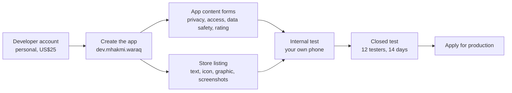
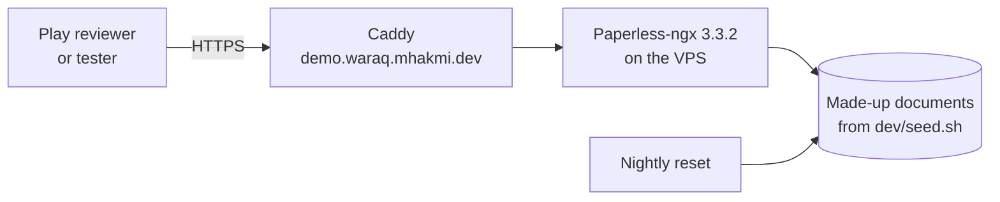

# Putting Waraq on Google Play

This page is for Mohammed, who publishes Waraq on Google Play. It holds what the Play Console asks for, ready to paste, and the steps from a new developer account to the closed test. [Releasing Waraq](release.md) covers how to build and check a bundle.

Each statement about the app is marked **Checked** when it was read from the code or a built bundle, and **Inferred** when it is a reading of Google's rules that was not tested here. Nothing here has been entered in Play Console.



## 1. The upload key

The upload key signs every bundle that you send to Play. Play App Signing keeps a separate key that signs the app on phones.

| | |
|---|---|
| Keystore | `.dev-data/signing/waraq-upload.jks` in the main checkout, `/Users/mhakmi/mhakmi.dev/waraq` |
| Passwords and alias | `.dev-data/signing.env`, which `dev/android.sh bundle` reads |
| Alias | `upload` |
| Key | RSA 4096, valid for 10,000 days, until 15 March 2054 |
| Owner | `CN=Mohammed Hakmi, C=CA` |
| SHA-256 fingerprint | `D0:8C:99:F0:BF:AD:DD:E2:02:BB:6C:75:E0:A4:9D:1D:FF:67:B6:83:DE:E7:C2:3F:FD:72:0E:99:A1:FC:17:64` |

Git ignores `.dev-data`, so neither file is in the repo. The keystore and the key share one random password. It is written only in `signing.env`.

Before the first upload, back up both:

1. Copy `waraq-upload.jks` to a second place that is not this Mac, such as an encrypted drive.
2. Save the password from `signing.env` in your password manager, with the alias `upload`.

If the key is lost after the first upload, you can ask Play to reset it in Play Console ([app signing](https://support.google.com/googleplay/android-developer/answer/9842756)). Until the reset, you cannot ship an update.

### The first signed bundle

**Checked** on 28 October 2026. `dev/android.sh bundle` built `.dev-data/bundles/waraq-0.3.2-5.aab`, 74 MB, version 0.3.2, versionCode 5. It has the Paper loop icon and the Privacy policy row in Settings. `keytool -printcert` shows it is signed by `CN=Mohammed Hakmi, C=CA`, with the fingerprint above. The script printed no "NOT FOR UPLOAD" banner, and `dev/release-check.sh` passed every check.

This is the bundle for the first upload. Play has never seen versionCode 5. After the first upload, raise `android.versionCode` in `app.config.ts` for each new bundle.

## 2. Store listing

**App name.** Waraq

**Short description** (77 of 80 characters):

```text
Scan, find, and file documents on the Paperless-ngx server you host yourself.
```

**Full description** (2,283 of 4,000 characters). Every line is **Checked** against the code.

```text
Waraq is an Android app for Paperless-ngx servers that you host yourself. Scan paper with your phone, file it on your server, and find any document again.

Waraq is an independent app. It is not made by or affiliated with the Paperless-ngx project. It needs Paperless-ngx 3.0 or newer.

SCAN AND UPLOAD
• Scan with Google's document scanner, which runs on your phone.
• Scan several documents in one go, each with several pages. Before you upload, rotate, reorder, and delete pages, split a document in two, or move pages between documents.
• Set the title, date, tags, correspondent, document type, and custom fields for every document at once, or for one document.
• Share PDFs and pictures into Waraq from other apps, or pick them from your phone.
• Uploads wait while you are offline and carry on after the app is closed. Waraq checks the server before it sends again, so a document is not uploaded twice.

FIND AND FILE
• Search your documents, filter by tag, correspondent, type, and date, and use the saved views from your server.
• Open a document in your PDF app, share it, or download it.
• Edit the title, date, correspondent, document type, tags, and custom fields. Add and delete notes.
• Go through your inbox and mark documents done, with undo.
• Lists and documents you opened before show while you are offline.
• Manage tags, correspondents, document types, storage paths, and custom fields in Settings.

SIGN IN TO YOUR SERVER
• Sign in with a username and password, with a two-factor code, or with an API token.
• HTTPS, including servers that use a certificate authority you installed on your phone.
• Plain HTTP for addresses on your home network or VPN, with a warning.
• Extra headers for proxies such as Cloudflare Access.
• If sign-in fails, Waraq shows which step failed and how to fix it.

PRIVACY
Waraq has no server of its own. It sends your documents and sign-in details only to the server you sign in to. It has no ads and no analytics of its own. The document scanner is part of Google Play services and runs on your phone. Google's ML Kit, which the scanner uses, sends diagnostic data to Google.

Light and dark themes, following your phone or your choice.

Waraq is open source under the MIT license. The code is at https://github.com/mhakmi/waraq.
```

The repo is public under the MIT license, so the last paragraph says so, as the design notes suggest.

**Category.** Productivity.

**Tags.** Play lets you pick up to five tags from its own list. Look for these, or the nearest ones on the list: Document management, Scanner, Productivity, Files. **Inferred**, because the list is visible only inside Play Console.

**Contact details.** Email `mhakmi.dev@gmail.com`. Website `https://mhakmi.dev/waraq` when the site has that page.

## 3. Graphics

| Asset | Size | File |
|---|---|---|
| App icon | 512 by 512 | `assets/icon/store-512.png`, copied from `brand/waraq/paper-loop/png/store-512.png` |
| Feature graphic | 1024 by 500, PNG without alpha | `docs/play/feature-graphic.png` |
| Phone screenshots | 1080 by 2400 | `docs/play/screenshots/` |

`dev/feature-graphic.swift` draws the feature graphic from the brand folder. It uses the mark from `launcher.svg`, the brand's IBM Plex Sans, and the background `#1f3b6e`. To draw it again:

```sh
swift dev/feature-graphic.swift /Users/mhakmi/mhakmi.dev/brand docs/play/feature-graphic.png
```

`dev/play-screenshots.sh` takes the phone screenshots on the emulator, against the dev server's made-up documents. It sets a clean status bar with Android's demo mode: 12:00, a full battery, and full Wi-Fi. Claim and boot the emulator and install the newest bundle first, as the script's header says. Upload them in this order:

| File | Screen |
|---|---|
| `01-documents.png` | Documents, sorted by title |
| `02-document.png` | The page of one document |
| `03-edit-custom-fields.png` | Edit details, with three custom fields changed |
| `04-batch.png` | A batch of two scanned documents |
| `05-batch-details.png` | Batch details, with the tag Bills for every document |
| `06-uploads.png` | Uploads, with both documents done |
| `07-settings.png` | Settings |
| `08-documents-dark.png` | Documents in the dark theme |

The screenshots show the app before the Paper loop icon. No screen shows the app icon, so they stay valid after the icon change.

## 4. Privacy policy

The policy text is in [privacy.md](privacy.md). It goes on `https://mhakmi.dev/waraq/privacy`, and that address goes in **App content > Privacy policy**.

Google wants the policy in the Play Console field and reachable inside the app too ([privacy policy](https://support.google.com/googleplay/android-developer/answer/9888076)), as the [design](design.md#google-play-requirements-that-change-the-plan) notes. **Checked**: Settings has a "Privacy policy" row in its "Other" group that opens that address, and a "Source code" row that opens the GitHub repo.

## 5. Data safety

Answers for **App content > Data safety**, from [Releasing Waraq](release.md#data-safety-form), checked again against the code on 28 October 2026.

| Question | Answer | Why |
|---|---|---|
| Does your app collect or share any of the required user data types? | Yes | Documents and pictures go to the user's server. Google counts that as collected. ML Kit sends diagnostics to Google. |
| Is all of the user data collected by your app encrypted in transit? | No | Waraq allows plain HTTP for home network and VPN addresses. **Checked** in `plugins/network-security.ts` and `normalizeServerUrl`. |
| Which account creation methods does your app support? | My app does not allow users to create an account | Users sign in to an account that already exists on their own server. Waraq has no sign-up. **Checked.** |
| Do you provide a way for users to request that their data is deleted? | Yes | Documents are deleted on the user's server or in the app. Sign out removes the account from the phone. **Inferred** that this fits the question. |

Declare these data types. Mark each one **Collected: Yes**, **Shared: No**, and **Processed ephemerally: No**.

| Data type | Required or optional | Purpose | What it is |
|---|---|---|---|
| Files and docs | Required | App functionality | Documents, titles, notes, tags, and custom fields sent to the user's server. **Checked.** |
| Photos | Optional | App functionality | Scanned pages and pictures shared into Waraq, sent to the user's server as PDFs. **Checked.** |
| Personal info > User IDs | Required | App functionality, Account management | The username sent to the user's server at sign-in. [Releasing Waraq](release.md) leaves it out. Declare it, because the username leaves the phone. **Inferred.** |
| App info and performance > Diagnostics | Optional | Analytics | ML Kit's diagnostics to Google, only when the user scans. **Inferred** from Google's ML Kit page. |
| Device or other IDs | Optional | Analytics | ML Kit's per-installation identifier. **Inferred**, as above. |
| App activity > In-app search history | Optional | App functionality | The search terms sent to the user's server. **Inferred.** |
| Personal info > Email address | Optional | App functionality, Account management | A username can be an email address, and it goes to the user's server at sign-in. **Inferred.** |

**Not shared.** Each transfer goes to the user's own server because the user asked for it. ML Kit's data goes to Google as a service provider that processes it for the app, which the form does not count as sharing. **Inferred.**

**Not declared.** The crash log leaves the phone only when the user picks an app in the share sheet. Waraq receives nothing, so it is not collected. **Inferred.** The password goes to the user's server once and is not stored. Declare it only if Play's form asks about passwords under User IDs. **Inferred.**

## 6. Content rating

Answers for the IARC questionnaire in **App content > Content rating**. **Inferred**. The questionnaire was not opened for this page, so its wording may differ.

| Question | Answer |
|---|---|
| Category | All other app types, or Utility, Productivity, Communication, or Other, whichever the form offers |
| Violence, fear, sexuality, crude humor, language, drugs, alcohol, tobacco | No |
| Gambling, simulated gambling, or real-money purchases | No |
| Does the app let users interact or exchange content with each other? | No. Users share nothing through Waraq. It shows only what their own server returns. |
| Does the app share the user's current physical location with other users? | No |
| Does the app allow users to buy digital goods? | No |
| Is the app a web browser or search engine? | No |
| Does the app contain ads? | No |

Expected result: IARC 3+, ESRB Everyone, PEGI 3, USK 0. **Inferred.**

The other App content forms:

| Form | Answer |
|---|---|
| Ads | No ads. **Checked.** |
| App access | All or some features are restricted. Give the demo server's sign-in details, as in [Demo server for Play's reviewers](#7-demo-server-for-plays-reviewers). |
| Target audience | 18 and over. The app is for people who run their own server. |
| News app | No |
| Government app | No |
| Financial features | None |
| Health | None |

## 7. Demo server for Play's reviewers

Play's reviewers must be able to sign in. Their sign-in details "must be accessible at all times, reusable, and valid regardless of user location" ([app access](https://support.google.com/googleplay/android-developer/answer/15748846)). Waraq has no server of its own, so the reviewer needs a Paperless-ngx server with made-up documents. The same server serves testers who have no server.



The plan:

1. Pick a name, for example `demo.waraq.mhakmi.dev`, and add an A record that points at the VPS.
2. On the VPS, run Paperless-ngx 3.3.2 with Docker Compose, using `dev/compose.yaml` as the starting point. Set a new `PAPERLESS_SECRET_KEY`, a new admin password, and `PAPERLESS_URL=https://demo.waraq.mhakmi.dev`. Bind Paperless to `127.0.0.1` only.
3. Put Caddy in front of it, or the reverse proxy that the VPS already runs. Caddy gets the HTTPS certificate from Let's Encrypt by itself.
4. Load the made-up documents with `dev/seed.sh`, pointed at the demo server with `PAPERLESS_URL` and the new admin password.
5. Make a user `reviewer` with a long random password. Give it view, add, and change on documents, tags, correspondents, document types, notes, and saved views, and view on UI settings, which Waraq needs to sign in. Give it no admin rights and no MFA. Paperless-ngx passwords do not expire.
6. Reset the documents each night: delete what the reviewer added and run `dev/seed.sh` again. Keep the `reviewer` user, so the password stays valid.
7. Sign in from the app with those details once, and scan and upload one page.
8. In **App content > App access**, enter the address, the username, and the password, with this note: "Waraq is a client for Paperless-ngx servers. Sign in to this demo server, which holds made-up documents. Tap Scan to try the scanner."

Paperless-ngx allows five sign-in attempts a minute. A reviewer who mistypes a few times waits a minute.

Steps 1 to 3 and step 8 need the VPS, the DNS, and the Play account, so only you can do them. Nothing here is deployed yet.

## 8. Closed test

A personal account made after 13 November 2023 needs a closed test with at least 12 testers who stay opted in for 14 days in a row before it can apply for production ([testing requirements](https://support.google.com/googleplay/android-developer/answer/14151465)). Plan three to four weeks from the first closed build to the store. **Inferred** from that page.

Testers need a Paperless-ngx 3.0 server of their own, or the demo server.

In Play Console, do these steps. The menu names are **Inferred**, because Console was not opened for this page.

1. Make a Google Group, for example `waraq-testers@googlegroups.com`, and set it so people can ask to join. A group is easier than an email list, because you add people in the group and not in Console.
2. Go to **Test and release > Testing > Closed testing** and create a track.
3. Under **Testers**, add the Google Group.
4. Choose the countries, starting with Canada and the United States.
5. Create a release, upload the `.aab`, and write release notes.
6. Send the release for review. **Inferred**: the first review can take several days.
7. When it is approved, copy the opt-in link from the **Testers** tab.

How a tester joins:

1. Join the Google Group with the Google account they use on their phone.
2. Open the opt-in link and tap **Become a tester**.
3. Install Waraq from the Play Store link on that page.
4. Stay opted in, with the app installed, for at least 14 days.

What to tell testers:

```text
Thanks for testing Waraq, an Android app for Paperless-ngx 3.0 and newer.

1. Join the group: <group link>
2. Open this link on your phone and tap "Become a tester": <opt-in link>
3. Install Waraq from the Play Store.
4. Sign in to your own Paperless-ngx server, or to the demo server:
   <demo address>, user <user>, password <password>
5. Please keep the app installed for 14 days. Google counts the days.

Try scanning a few letters, filing your inbox, and finding an old document.
Send problems to mhakmi.dev@gmail.com. If the app shows an error,
open Settings > Send a crash report and send it the same way.
```

Google asks for 12 testers who have been opted in for the last 14 days in a row. If the count drops below 12, the 14 days can start again. **Inferred.** Recruit 15 or more, so one or two who leave do not reset the count. Check the count in Console every few days.

## 9. What only you can do, in order

1. Make the personal Play developer account: US$25, ID, and a verified Android phone. Do this first, because the identity check takes days. Play also verifies the contact email address and phone number.
2. Back up `waraq-upload.jks` and save its password in your password manager.
3. Read and approve the listing text, the feature graphic, the screenshots, and the privacy policy on this page.
4. Ask the site thread to publish [privacy.md](privacy.md) at `https://mhakmi.dev/waraq/privacy`.
5. Set up the demo server, with your go-ahead for the deploy and the DNS record.
6. Create the app in Play Console with the package `dev.mhakmi.waraq`. This registers the package name for good.
7. Fill in the App content forms from sections 4 to 7, after the demo server works from the app, and the store listing from sections 2 and 3.
8. Build the bundle with the new icon and the Privacy policy row. The orchestrator builds it with `dev/android.sh bundle`.
9. Upload that bundle to the internal test track, install it from Play on your phone, and sign in to your own server.
10. Make the Google Group and find at least 12 testers. Recruit 15.
11. Start the closed test and send the testers the message above.
12. After 14 days with 12 or more testers, apply for production.
