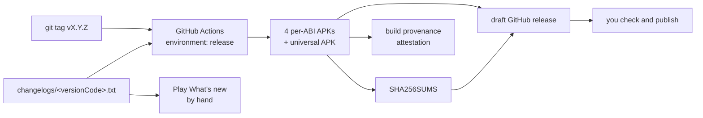

# How open-source Android apps publish to GitHub Releases

This page compares how twelve open-source Android apps put their builds on GitHub Releases. Most of them are also on Google Play. It ends with a recommendation for Waraq.

Every statement links to the file or release it was read from, on 2026-10-30. A statement marked **Inferred** was not read anywhere. It is a reading of what the files imply.

The apps:

| App | Repo | On Play | APKs on GitHub |
| --- | --- | --- | --- |
| Immich (mobile) | [immich-app/immich](https://github.com/immich-app/immich) | yes | yes |
| Ente Auth | [ente-io/ente](https://github.com/ente-io/ente/blob/main/mobile/apps/auth/README.md) | yes | yes |
| Aegis | [beemdevelopment/Aegis](https://github.com/beemdevelopment/Aegis/blob/master/README.md) | yes | yes |
| AntennaPod | [AntennaPod/AntennaPod](https://github.com/AntennaPod/AntennaPod) | yes | no |
| Tusky | [tuskyapp/Tusky](https://github.com/tuskyapp/Tusky) | yes | yes, one APK |
| Fossify Gallery | [FossifyOrg/Gallery](https://github.com/FossifyOrg/Gallery) | yes | yes |
| Mihon | [mihonapp/mihon](https://github.com/mihonapp/mihon) | no | yes |
| Catima | [CatimaLoyalty/Android](https://github.com/CatimaLoyalty/Android) | yes | yes |
| Bitwarden | [bitwarden/android](https://github.com/bitwarden/android) | yes | yes |
| Home Assistant | [home-assistant/android](https://github.com/home-assistant/android) | yes | yes |
| Organic Maps | [organicmaps/organicmaps](https://github.com/organicmaps/organicmaps) | yes | yes |
| Obtainium | [ImranR98/Obtainium](https://github.com/ImranR98/Obtainium) | no | yes |

## 1. What starts a release

| App | Trigger | Source |
| --- | --- | --- |
| Immich | `workflow_dispatch` on a `release/*` branch. It builds, creates a draft release, then a job in the `release` environment publishes it. | [draft-release.yml](https://github.com/immich-app/immich/blob/main/.github/workflows/draft-release.yml), [prepare-release.yml](https://github.com/immich-app/immich/blob/main/.github/workflows/prepare-release.yml) |
| Ente Auth | `workflow_dispatch` with `action=start` creates a `release/auth-vX` branch. A push to that branch builds a draft RC release. `action=promote` publishes it. Nightlies run on a schedule. | [app-release.md](https://github.com/ente-io/ente/blob/main/.github/docs/app-release.md), [auth-build.yml](https://github.com/ente-io/ente/blob/main/.github/workflows/auth-build.yml), [app-release.yml](https://github.com/ente-io/ente/blob/main/.github/workflows/app-release.yml) |
| Aegis | No release workflow. CI only builds a debug APK on push and pull request. **Inferred:** releases are built and uploaded by hand. | [build-app-workflow.yaml](https://github.com/beemdevelopment/Aegis/blob/master/.github/workflows/build-app-workflow.yaml) |
| AntennaPod | No release workflow. A `workflow_dispatch` job only drafts a changelog as an artifact. | [create-changelog.yml](https://github.com/AntennaPod/AntennaPod/blob/develop/.github/workflows/create-changelog.yml) |
| Tusky | Any pushed tag builds the Play bundle and uploads it to the internal track. The GitHub APK is not built by CI. | [deploy-release.yml](https://github.com/tuskyapp/Tusky/blob/develop/.github/workflows/deploy-release.yml) |
| Fossify | A release-PR tool. A change to `CHANGELOG.md` on `main` opens a PR that bumps the version and writes the Play changelog. Merging it changes `.fossify/release-marker.txt`, which starts the release. | [prepare-release-pr.yml](https://github.com/FossifyOrg/Gallery/blob/main/.github/workflows/prepare-release-pr.yml), [release.yml](https://github.com/FossifyOrg/Gallery/blob/main/.github/workflows/release.yml), [shared release.yml](https://github.com/FossifyOrg/.github/blob/main/.github/workflows/release.yml) |
| Mihon | Pushed tag `v*`. | [release.yml](https://github.com/mihonapp/mihon/blob/main/.github/workflows/release.yml) |
| Catima | By hand, following a written checklist. | [RELEASE_STEPS.md](https://github.com/CatimaLoyalty/Android/blob/main/docs/RELEASE_STEPS.md) |
| Bitwarden | Push to `release/**` builds. A separate `workflow_dispatch`, given the build run ID, creates a draft release. | [build.yml](https://github.com/bitwarden/android/blob/main/.github/workflows/build.yml), [github-release.yml](https://github.com/bitwarden/android/blob/main/.github/workflows/github-release.yml) |
| Home Assistant | A weekly cron dispatches `onPush.yml` with `beta=true`. That creates a GitHub pre-release and uploads to Play beta. Marking the release as released on GitHub promotes Play beta to production. | [weekly.yml](https://github.com/home-assistant/android/blob/main/.github/workflows/weekly.yml), [onPush.yml](https://github.com/home-assistant/android/blob/main/.github/workflows/onPush.yml), [release.yml](https://github.com/home-assistant/android/blob/main/.github/workflows/release.yml) |
| Organic Maps | `workflow_dispatch` with a checkbox per store (F-Droid, Google, Huawei, web APK). | [android-release.yaml](https://github.com/organicmaps/organicmaps/blob/master/.github/workflows/android-release.yaml) |
| Obtainium | `workflow_dispatch`. | [release.yml](https://github.com/ImranR98/Obtainium/blob/main/.github/workflows/release.yml) |

Pattern. Only Mihon and Tusky use a plain tag push. The larger projects use `workflow_dispatch` or a release branch, and create a draft that a person publishes. Immich and Ente also put the publish step behind a GitHub environment.

## 2. What is attached

| App | APKs | AAB | Checksums | Signing fingerprint published |
| --- | --- | --- | --- | --- |
| Immich | Universal (171 MB) plus arm64-v8a, armeabi-v7a, x86_64. No x86. ([v3.3.5](https://github.com/immich-app/immich/releases/tag/v3.3.5)) | no | None as files. Its F-Droid job reads GitHub's own per-asset `digest` field ([fdroid.yml](https://github.com/immich-app/immich/blob/main/.github/workflows/fdroid.yml)). | not found |
| Ente Auth | One universal APK, 61 MB ([auth-v4.4.26](https://github.com/ente-io/ente/releases/tag/auth-v4.4.26)) | no | `SHA256SUMS` file ([auth-build.yml](https://github.com/ente-io/ente/blob/main/.github/workflows/auth-build.yml)) | not found |
| Aegis | One APK, 6 MB ([v3.4.3](https://github.com/beemdevelopment/Aegis/releases/tag/v3.4.3)) | no | none | Yes. MD5, SHA-1 and SHA-256 of the certificate, plus the `apksigner verify --print-certs` command ([README](https://github.com/beemdevelopment/Aegis/blob/master/README.md#verification)) |
| AntennaPod | none ([3.12.3](https://github.com/AntennaPod/AntennaPod/releases/tag/3.12.3)) | no | none | not found |
| Tusky | One APK named `133.apk` ([v29.0](https://github.com/tuskyapp/Tusky/releases/tag/v29.0)) | no | none | not found |
| Fossify Gallery | Universal (36 MB) plus four per-ABI APKs. Each APK has its own versionCode (30 to 34). ([1.14.1](https://github.com/FossifyOrg/Gallery/releases/tag/1.14.1)) | no | none | not found |
| Mihon | Universal (65 MB), a FOSS universal, and four per-ABI APKs (23 to 28 MB) ([v0.21.3](https://github.com/mihonapp/mihon/releases/tag/v0.21.3)) | no | none | not found |
| Catima | One FOSS APK, 5 MB ([v2.45.2](https://github.com/CatimaLoyalty/Android/releases/tag/v2.45.2)) | no | `SHA256SUMS` file | not found |
| Bitwarden | Play-flavor APK and F-Droid-flavor APK ([v2026.10.1-bwpm](https://github.com/bitwarden/android/releases/tag/v2026.10.1-bwpm)) | Built, then removed before release ([github-release.yml](https://github.com/bitwarden/android/blob/main/.github/workflows/github-release.yml)) | One `<file>-sha256.txt` per APK | not found |
| Home Assistant | Full, minimal, Wear and Automotive APKs ([2026.10.1](https://github.com/home-assistant/android/releases/tag/2026.10.1)) | no | none | not found |
| Organic Maps | One universal web-flavor APK ([android-release.yaml](https://github.com/organicmaps/organicmaps/blob/master/.github/workflows/android-release.yaml)) | Built as a CI artifact only | A `.sha256sum` file and the hash in the release body | not found |

No workflow read here calls `actions/attest-build-provenance`. Bitwarden's release job requests `id-token: write`, but no attestation step was found in it ([github-release.yml](https://github.com/bitwarden/android/blob/main/.github/workflows/github-release.yml)).

Pattern. Nobody attaches an AAB. Apps with large native code (Immich, Mihon, Fossify) attach per-ABI APKs next to a universal one. Catima's README links an Obtainium config with `autoApkFilterByArch: true`, so Obtainium picks the per-ABI file that fits the phone ([README](https://github.com/CatimaLoyalty/Android/blob/main/README.md)).

## 3. Which key signs the GitHub APK

| App | GitHub APK signed with | What users are told | Source |
| --- | --- | --- | --- |
| Aegis | The same key as Play | "APK releases on Google Play and GitHub are signed using the same key." | [README](https://github.com/beemdevelopment/Aegis/blob/master/README.md#verification) |
| Bitwarden | A keystore named `app_play-keystore.jks` (alias `bitwarden`). The Play bundle is signed with a separate `app_upload-keystore.jks` (alias `upload`). **Inferred:** the first is the app signing key that Play also holds, so GitHub and Play installs match. | not found | [build.yml](https://github.com/bitwarden/android/blob/main/.github/workflows/build.yml) |
| Home Assistant | `ORIGINAL_KEYSTORE_FILE` for the GitHub APKs. `UPLOAD_KEYSTORE_FILE` for the Play bundle. **Inferred:** the same split as Bitwarden. | not found | [onPush.yml](https://github.com/home-assistant/android/blob/main/.github/workflows/onPush.yml) |
| Organic Maps | One `RELEASE_KEYSTORE` for the Google bundle, the Huawei bundle and the web APK. Whether Play re-signs with its own key is not visible. | not found | [android-release.yaml](https://github.com/organicmaps/organicmaps/blob/master/.github/workflows/android-release.yaml) |
| Fossify | One keystore (`ANDROID_KEYSTORE_BASE64`) for both the Play bundle and the FOSS APK. Whether Play re-signs is not visible. | not found | [shared release.yml](https://github.com/FossifyOrg/.github/blob/main/.github/workflows/release.yml) |
| Ente Auth | One keystore (`SIGNING_KEY_AUTH`) for both the "independent" APK and the Play bundle. Whether Play re-signs is not visible. | The README lists GitHub, Play and F-Droid as sources. It says nothing about switching. | [auth-build.yml](https://github.com/ente-io/ente/blob/main/.github/workflows/auth-build.yml), [README](https://github.com/ente-io/ente/blob/main/mobile/apps/auth/README.md) |
| Immich | `KEY_JKS`. The Play upload is not in CI. | not found | [build-mobile.yml](https://github.com/immich-app/immich/blob/main/.github/workflows/build-mobile.yml) |
| Catima | A local keystore, alias `catima`, with `apksigner`. The Play APK comes from the same build. | not found | [RELEASE_STEPS.md](https://github.com/CatimaLoyalty/Android/blob/main/docs/RELEASE_STEPS.md), [build.sh](https://github.com/CatimaLoyalty/Android/blob/main/build.sh) |
| Mihon (not on Play) | Its own key | A troubleshooting entry for `INSTALL_FAILED_UPDATE_INCOMPATIBLE` says to back up, uninstall, and reinstall. | [troubleshooting](https://github.com/mihonapp/website/blob/main/website/src/docs/guides/troubleshooting/index.md) |

What Google says. The Play App Signing page lists two ways to use one signing key in every store ([Play App Signing](https://support.google.com/googleplay/android-developer/answer/9842756)):

1. Let Google generate the key, then download a signed universal APK from Play Console or the Play Developer API and distribute that.
2. Generate your own app signing key and give Google a copy when you set up Play App Signing.

The same page says three more things that matter for Waraq:

- A new app is enrolled by default in "quantum-ready, hybrid signing with Google-generated keys".
- The default can be changed to your own key "before a release is rolled out in the open testing or production track". A closed test does not close that window.
- Android 17 and higher strictly enforce an upgraded hybrid key. **Inferred:** apps that bring their own key may not get the hybrid key. The page does not say.

Pattern. The two biggest apps that ship both channels (Bitwarden, Home Assistant) keep two keystores. One is an upload key for Play. The other is a key whose APKs match Play installs. Aegis is the only one that tells users so in writing.

## 4. Keystores and passwords in Actions

| App | Secret names | How the keystore is decoded | Environment |
| --- | --- | --- | --- |
| Mihon | `SIGNING_KEY`, `KEY_STORE_PASSWORD`, `ALIAS`, `KEY_PASSWORD` | `echo "$SIGNING_KEY" \| base64 -d > "${{ runner.temp }}/antsy.keystore"`. Passwords go to Gradle as env vars. | none ([release.yml](https://github.com/mihonapp/mihon/blob/main/.github/workflows/release.yml)) |
| Ente Auth | `SIGNING_KEY_AUTH`, `SIGNING_KEY_ALIAS_AUTH`, `SIGNING_KEY_PASSWORD_AUTH`, `SIGNING_STORE_PASSWORD_AUTH`, `SERVICE_ACCOUNT_JSON` | `printf '%s' ... \| base64 -d > "$RUNNER_TEMP/ente_auth_key.jks"` | `production` ([auth-build.yml](https://github.com/ente-io/ente/blob/main/.github/workflows/auth-build.yml)) |
| Fossify | `ANDROID_KEYSTORE_BASE64`, `SIGNING_KEY_ALIAS`, `SIGNING_KEY_PASSWORD`, `SIGNING_STORE_PASSWORD`, `SERVICE_ACCOUNT_JSON_KEY_BASE64` | A shared composite action writes `app/release.jks` ([decode-secrets](https://github.com/FossifyOrg/.github/blob/main/.github/actions/decode-secrets/action.yml)). A cleanup action runs with `if: always()`. | none ([shared release.yml](https://github.com/FossifyOrg/.github/blob/main/.github/workflows/release.yml)) |
| Immich | `KEY_JKS`, `ALIAS`, `ANDROID_KEY_PASSWORD`, `ANDROID_STORE_PASSWORD` | `printf "%s" $KEY_JKS \| base64 -d > android/key.jks`. Skipped for fork PRs. | `release` on the publish job ([build-mobile.yml](https://github.com/immich-app/immich/blob/main/.github/workflows/build-mobile.yml), [draft-release.yml](https://github.com/immich-app/immich/blob/main/.github/workflows/draft-release.yml)) |
| Tusky | `KEYSTORE`, `KEY_ALIAS`, `KEYSTORE_PASSWORD`, `KEY_PASSWORD`, `SERVICE_ACCOUNT_JSON` | `r0adkll/sign-android-release` takes the base64 keystore directly | `Release` ([deploy-release.yml](https://github.com/tuskyapp/Tusky/blob/develop/.github/workflows/deploy-release.yml)) |
| Home Assistant | `ORIGINAL_KEYSTORE_FILE`, `ORIGINAL_KEYSTORE_FILE_PASSWORD`, `ORIGINAL_KEYSTORE_ALIAS`, `ORIGINAL_KEYSTORE_ALIAS_PASSWORD`, and the same four with `UPLOAD_` | A composite action base64-decodes into each module ([inflate-secrets](https://github.com/home-assistant/android/blob/main/.github/actions/inflate-secrets/action.yml)) | none ([onPush.yml](https://github.com/home-assistant/android/blob/main/.github/workflows/onPush.yml)) |
| Organic Maps | `RELEASE_KEYSTORE`, `SECURE_PROPERTIES`, `GOOGLE_PLAY_JSON` | `echo "$RELEASE_KEYSTORE" \| base64 -d > android/app/release.keystore` | `production` ([android-release.yaml](https://github.com/organicmaps/organicmaps/blob/master/.github/workflows/android-release.yaml)) |
| Bitwarden | Keystore files and passwords live in Azure Key Vault, not in Actions secrets | Downloaded with `az storage blob download` after an Azure login | ([build.yml](https://github.com/bitwarden/android/blob/main/.github/workflows/build.yml)) |

Pattern. Almost everyone stores the keystore as one base64 secret plus three plain secrets (alias, store password, key password). They decode it at build time and pass the passwords to Gradle as environment variables. Ente, Immich, Tusky and Organic Maps add a GitHub environment, which can require a reviewer before the job sees the secrets.

## 5. Release notes

| App | Notes source | Shared with Play "What's new" | Source |
| --- | --- | --- | --- |
| Tusky | Hand-written. `fastlane/metadata/android/en-US/changelogs/<versionCode>.txt` plus `CHANGELOG.md`. | Yes. CI copies the newest changelog file to `whatsnew/whatsnew-en-US`. | [deploy-release.yml](https://github.com/tuskyapp/Tusky/blob/develop/.github/workflows/deploy-release.yml), [133.txt](https://github.com/tuskyapp/Tusky/blob/develop/fastlane/metadata/android/en-US/changelogs/133.txt) |
| Fossify | Hand-written `CHANGELOG.md` in Keep a Changelog format. The release PR writes `changelogs/<versionCode>.txt` for each ABI versionCode. | Yes. The same text goes to the GitHub body and to fastlane. | [shared prepare-release-pr.yml](https://github.com/FossifyOrg/.github/blob/main/.github/workflows/prepare-release-pr.yml) |
| Catima | Hand-written `CHANGELOG.md`. A workflow turns it into fastlane changelogs and opens a PR. | Yes, through `fastlane supply`. | [changelog-to-fastlane.yml](https://github.com/CatimaLoyalty/Android/blob/main/.github/workflows/changelog-to-fastlane.yml), [RELEASE_STEPS.md](https://github.com/CatimaLoyalty/Android/blob/main/docs/RELEASE_STEPS.md) |
| Organic Maps | Hand-written Play file `android/app/src/google/play/release-notes/en-US/default.txt`. | Yes. The GitHub body is that file plus an Obtainium link and the SHA-256. | [android-release.yaml](https://github.com/organicmaps/organicmaps/blob/master/.github/workflows/android-release.yaml) |
| Ente Auth | Entries in `mobile/apps/auth/changes`, turned into both the GitHub body and the Play notes by a script. The draft is edited by hand before promotion. | Yes | [auth-build.yml](https://github.com/ente-io/ente/blob/main/.github/workflows/auth-build.yml), [app-release.md](https://github.com/ente-io/ente/blob/main/.github/docs/app-release.md) |
| Immich | Generated by a script from PRs, with a hand-written note on top | no | [draft-release.yml](https://github.com/immich-app/immich/blob/main/.github/workflows/draft-release.yml), [v3.3.5](https://github.com/immich-app/immich/releases/tag/v3.3.5) |
| Bitwarden | Hand-written overview plus `gh release create --generate-notes` | not found | [github-release.yml](https://github.com/bitwarden/android/blob/main/.github/workflows/github-release.yml) |
| Home Assistant | A generated `changelogGithub` file. Stable releases get a hand-written highlights list. | not found | [onPush.yml](https://github.com/home-assistant/android/blob/main/.github/workflows/onPush.yml), [2026.10.1](https://github.com/home-assistant/android/releases/tag/2026.10.1) |
| Mihon | A fixed template in the workflow, then edited by hand in the draft | not on Play | [release.yml](https://github.com/mihonapp/mihon/blob/main/.github/workflows/release.yml) |
| Aegis, AntennaPod | Hand-written in the release | not found | [Aegis v3.4.3](https://github.com/beemdevelopment/Aegis/releases/tag/v3.4.3), [AntennaPod 3.12.3](https://github.com/AntennaPod/AntennaPod/releases/tag/3.12.3) |

Pattern. Apps that care about Play keep one short, user-facing text per versionCode and send it to both GitHub and Play. The fastlane path `fastlane/metadata/android/en-US/changelogs/<versionCode>.txt` is the common home for it.

## 6. Pre-releases and betas

| App | How a beta is marked | Source |
| --- | --- | --- |
| Immich | A version ending in `-rc.N` sets `--prerelease`. The F-Droid job skips pre-releases. | [draft-release.yml](https://github.com/immich-app/immich/blob/main/.github/workflows/draft-release.yml), [fdroid.yml](https://github.com/immich-app/immich/blob/main/.github/workflows/fdroid.yml), [v3.4.0-rc.1](https://github.com/immich-app/immich/releases/tag/v3.4.0-rc.1) |
| Ente Auth | Nightlies are pre-releases in a separate `nightly` repo. RCs are drafts in the main repo. | [auth-build.yml](https://github.com/ente-io/ente/blob/main/.github/workflows/auth-build.yml) |
| Home Assistant | Every weekly build is a GitHub pre-release. Unmarking it promotes Play beta to production. | [onPush.yml](https://github.com/home-assistant/android/blob/main/.github/workflows/onPush.yml), [release.yml](https://github.com/home-assistant/android/blob/main/.github/workflows/release.yml) |
| Tusky | `vX.0-beta.N` tags, marked pre-release | [v29.0-beta.1](https://github.com/tuskyapp/Tusky/releases/tag/v29.0-beta.1) |
| Aegis | `vX-betaN` tags, marked pre-release | [v3.4-beta1](https://github.com/beemdevelopment/Aegis/releases/tag/v3.4-beta1) |
| Obtainium | `prerelease` comes from a beta flag in the version | [release.yml](https://github.com/ImranR98/Obtainium/blob/main/.github/workflows/release.yml) |
| Mihon | Always `prerelease: false`, always `draft: true` | [release.yml](https://github.com/mihonapp/mihon/blob/main/.github/workflows/release.yml) |
| AntennaPod | No betas on GitHub. The README sends testers to its beta program. | [README](https://github.com/AntennaPod/AntennaPod/blob/develop/README.md) |
| Fossify | No GitHub betas. Play gets a staged beta rollout (`track: beta`, `rollout: 0.05`). | [release.yml](https://github.com/FossifyOrg/Gallery/blob/main/.github/workflows/release.yml) |

## Recommendation for Waraq

### The signing key

Waraq has an upload key and no Play app yet. Two choices were asked about.

**(a) Make a dedicated app signing key and choose "use my own key".** GitHub APKs and Play installs then carry the same signature, so each can update the other. This is what Aegis states in its README, and what Bitwarden and Home Assistant do with separate upload and app-signing keystores (**Inferred** from the keystore names).

- Gain. A user can move between Play, GitHub and Obtainium without uninstalling. A future F-Droid build that reproduces the signed APK could match too (**Inferred**). There is one fingerprint to publish.
- Cost. You hold the one key every installed copy trusts, forever. If it leaks from the Actions secret, someone can sign an update that Play users accept too. If it is lost, GitHub users can never update again. Play can upgrade the key only on Android 17 and higher, per Google's page.
- Unknown. Google's page puts new apps on hybrid quantum-ready signing with Google-generated keys. It does not say whether an app with its own key gets that.

**(b) Let Google generate the key, and sign GitHub APKs with a separate key.** Users are told the channels do not mix. This is what Mihon's troubleshooting entry describes for any signature mismatch: back up, uninstall, reinstall.

- Gain. A leaked GitHub key cannot touch Play users. Google keeps and can rotate the Play key, with the hybrid default.
- Cost. A user who switches channels loses app data unless they export first. You publish two fingerprints.

There is a third path on Google's page. Let Google generate the key, then download Play's signed universal APK and attach it to GitHub. Signatures match and you hold no key. But the GitHub file is Play's build of the bundle, not a CI build, so the attestation below would vouch for a download rather than a build. GitHub releases also wait for Play processing.

My recommendation is (a). Waraq stores the user's own receipts on the phone, so a forced uninstall to switch channels costs real data. Same-key is what the well-run apps that ship both channels do. Do not sign GitHub APKs with the upload key. That would make a resettable key into a key users depend on (**Inferred**). The guards for (a):

1. Generate the app signing key offline, RSA 4096. Keep two offline backups, and keep it apart from the upload key.
2. Put it only in a GitHub environment named `release` with a required reviewer. That is you, so a stray workflow cannot sign.
3. Choose "use my own key" when you set up Play App Signing. Google's page says the switch is allowed until the first open-testing or production rollout, so the closed test does not force the choice. Make it before that rollout.

If you prefer that Google holds the key, take the third path over (b).

### Trigger

Push a tag `vX.Y.Z` that matches `version` in `app.config.ts`, and fail the run if they differ. The workflow builds, signs and uploads to a draft release. You publish the draft by hand after checking it, as Mihon, Immich and Bitwarden do. A tag with `-beta.N` or `-rc.N` becomes a pre-release, as Immich and Tusky do. Keep Play uploads by hand for now. The current `docs/release.md` already builds the bundle locally.

### Artifacts

- `waraq-vX.Y.Z-arm64-v8a.apk`, `-armeabi-v7a.apk`, `-x86_64.apk` and `-x86.apk`, plus `waraq-vX.Y.Z-universal.apk`. This is Mihon's set. The universal file is 70 to 100 MB, so the release notes should say most phones want arm64-v8a. Mihon puts a similar tip in its release body.
- No AAB. None of the twelve apps attach one.
- All splits can share one versionCode for GitHub. Fossify gives each ABI its own versionCode only because F-Droid needs that (**Inferred**).

### Checksums, attestation and fingerprint

- A `SHA256SUMS` file covering every APK, as Ente and Catima do.
- `actions/attest-build-provenance` on each APK, so anyone can run `gh attestation verify waraq-....apk --repo mhakmi/waraq`. None of the twelve apps do this. It is cheap and fits a portfolio repo that shows care (**Inferred**).
- A "Verify" section in the README with the `apksigner verify --print-certs` command and the SHA-256 certificate fingerprint, as Aegis does. AppVerifier and Obtainium users compare against that one value.

### Secret names

The existing local variables are `WARAQ_UPLOAD_*` (see `docs/release.md`). Under (a), CI holds only the app signing key:

| Secret | Holds |
| --- | --- |
| `WARAQ_SIGNING_KEYSTORE_BASE64` | `base64 -i waraq-signing.jks` |
| `WARAQ_SIGNING_KEY_ALIAS` | key alias |
| `WARAQ_SIGNING_STORE_PASSWORD` | keystore password |
| `WARAQ_SIGNING_KEY_PASSWORD` | key password |

All four live in the `release` environment, not as repository secrets. Decode to `$RUNNER_TEMP`, as Mihon and Ente do, never into the checkout. Pass the passwords to Gradle as env vars, the way `plugins/release-build.ts` already reads the upload key. Add `WARAQ_UPLOAD_*` and a Play service-account secret only if Play uploads move into CI.

### Release notes

Write one file per release at `fastlane/metadata/android/en-US/changelogs/<versionCode>.txt`, as Tusky, Fossify and Catima do. Paste the same text into Play's "What's new". The workflow uses it as the top of the GitHub body, then adds the ABI tip, the `SHA256SUMS` hint and the fingerprint line. Organic Maps builds its body the same way. Keep the file under Play's 500-character limit (**Inferred**, the limit was not read this session). A `CHANGELOG.md` is optional. Add one if the release notes need more detail than Play allows, as Tusky does.

