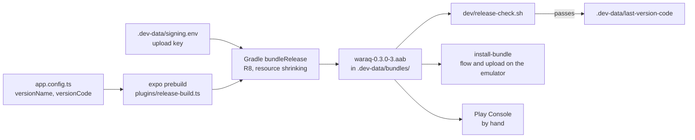

# Releasing Waraq

This page is for whoever builds a release of Waraq for Google Play. It covers how to build and check the app bundle, the version numbers, and what Play's App content forms need to know about the app. Nothing here uploads to Play.

Each statement about the app is marked **Checked** when it was read from the code or from a built bundle, and **Inferred** when it is a reading of Google's rules or of a library that was not tested here.

## How a release is made



## Build and check a release

1. Set the upload key in `.dev-data/signing.env`, as described in [The upload key](#the-upload-key). Without it, the bundle is signed with the debug key, and Play refuses it.
2. Raise `android.versionCode` in `app.config.ts`, and set `version` to the new version name.
3. Build the bundle.

   ```sh
   dev/android.sh bundle
   ```

   The script first makes the open-source licenses list again with `bun run licenses`. If `src/settings/licenses.json` changes, it stops, so commit the new list and run it again. Then it builds the bundle for all four Android ABIs, copies it to `.dev-data/bundles/waraq-<version>-<code>.aab`, prints its size and its signer, and runs `dev/release-check.sh` on it. When every check passes and the bundle is signed with the upload key, it records the versionCode in `.dev-data/last-version-code`.

4. Test the release build on the emulator. Claim the emulator first, and release it when you are done.

   ```sh
   dev/android.sh claim
   dev/android.sh boot
   dev/android.sh install-bundle
   dev/android.sh flow
   dev/android.sh upload
   dev/android.sh release
   ```

   `install-bundle` makes the APKs that Play would send to the emulator from the newest bundle, with bundletool, and installs them. So the flows run the code that Play ships, after R8 and resource shrinking.

5. Upload the `.aab` file in Play Console.

`dev/android.sh build` still makes the APK for phones, for arm64-v8a only and signed with the debug key. `dev/release-check.sh` takes that APK too.

## The upload key

Play App Signing keeps the key that signs the app on phones. Waraq signs each bundle with an upload key, which Play uses only to check that a bundle came from you. A lost upload key can be reset in Play Console ([app signing](https://support.google.com/googleplay/android-developer/answer/9842756)).

Keep the keystore outside the repo, with a backup. To make one, run `keytool` from the JDK and answer its questions:

```sh
keytool -genkeypair -v -keystore ~/keys/waraq-upload.jks -alias upload -keyalg RSA -keysize 2048 -validity 10000
```

Then write `.dev-data/signing.env`. Git does not track it. Each variable can also come from the environment.

```sh
WARAQ_UPLOAD_STORE_FILE=/Users/you/keys/waraq-upload.jks
WARAQ_UPLOAD_KEY_ALIAS=upload
WARAQ_UPLOAD_STORE_PASSWORD=the keystore password
WARAQ_UPLOAD_KEY_PASSWORD=the key password
```

`dev/android.sh bundle` exports them to Gradle. `plugins/release-build.ts` adds an `upload` signing config to the generated `android/app/build.gradle` that reads them from the environment, so no password is on a command line or in a file under `android/`. The same plugin turns on R8 minification and resource shrinking for release builds. The generated `android/` folder needs no hand edit. If the variables are set in your shell when you run `dev/android.sh build`, the APK is signed with the upload key too.

When some of the variables are set and others are not, the script stops. When none is set, it builds the bundle with the debug key and prints a "NOT FOR UPLOAD" banner.

## Version numbers

`version` (the versionName) and `android.versionCode` are set in `app.config.ts`, and nowhere else. Play refuses a versionCode that it has seen before, so `dev/android.sh bundle` refuses to build a versionCode that is not higher than the one in `.dev-data/last-version-code`. Only a bundle signed with the upload key that passes the release check updates that file. To build the same versionCode again, for example to test a bundle that was never uploaded, run:

```sh
dev/android.sh bundle --reuse-version-code
```

## GitHub Releases

`.github/workflows/release.yml` publishes APKs on the repo's Releases page. [release-research.md](release-research.md) explains why it works this way.

1. Write the notes for the release in `fastlane/metadata/android/en-US/changelogs/<versionCode>.txt`, in under 500 characters. Paste the same text into Play's "What's new".
2. Push a tag that matches `version` in `app.config.ts`, for example `git tag v0.3.2 && git push origin v0.3.2`. To build a tag made before its notes were written, run the workflow by hand from main: `gh workflow run release.yml -f tag=v0.3.2`.
3. The workflow builds one APK per ABI and a universal APK. It signs them with the app signing key, writes `SHA256SUMS`, attests where each APK was built, and drafts a release. A `v0.*` tag, or a tag with a `-` in it, becomes a pre-release.
4. Read the draft on the Releases page and publish it.

The APKs are signed with the app signing key, the same key Play signs with, so a copy from GitHub and a copy from Play can update each other. That holds only if Play App Signing is set up with "use my own key" and this key, before the first open test or production release. The upload key never signs a GitHub APK.

The workflow reads four secrets from the `release` environment: `WARAQ_SIGNING_KEYSTORE_BASE64`, `WARAQ_SIGNING_KEY_ALIAS`, `WARAQ_SIGNING_STORE_PASSWORD`, and `WARAQ_SIGNING_KEY_PASSWORD`. Without them, it builds the APKs, stops at the Sign step, and publishes nothing.

## What the release check looks at

`dev/release-check.sh <apk or aab>` fails when any of these is true. For an app bundle, it checks the universal APK that bundletool makes from it, which holds every native library and the same manifest.

| Check | Fails when |
|---|---|
| Permissions | The manifest asks for a permission that is not in `ALLOWED_PERMISSIONS` at the top of the script |
| Target SDK | `targetSdkVersion` is below 36 |
| Backup | `android:allowBackup` is true or missing, because Android allows backup when it is missing |
| Network | The network security config in the build differs from the one in `plugins/network-security.ts` |
| 16 KB pages | A 64-bit native library (arm64-v8a, x86_64) has a LOAD segment aligned below 16 KB, or a library stored in the APK is not at a 16 KB offset. 32-bit libraries are listed and skipped, because 16 KB pages apply to 64-bit devices only. |
| Trackers | `bun.lock` names an npm package in `DENIED_PACKAGES`, or the app's code or manifest names a Java package in `DENIED_JAVA_PACKAGES`. Both lists cover Firebase Analytics, Crashlytics, Sentry, AppsFlyer, the Facebook SDK, AdMob, and Bugsnag. |

The check reads the files with the SDK's `aapt2` and `zipalign`, the NDK's `llvm-readelf`, and bundletool. It changes nothing in the SDK. `dev/bundletool.sh` runs the bundletool that the Android Gradle plugin keeps in the Gradle cache, so nothing is downloaded for it.

## SDK levels

**Checked** in the 0.2.0 bundle:

| | API level |
|---|---|
| Minimum SDK | 24, Android 7.0 |
| Target SDK | 36, Android 16. Play requires 36 for new apps and updates since August 31, 2026 ([target API](https://developer.android.com/google/play/requirements/target-sdk)). |
| Compile SDK | 37 |

## Permissions

**Checked**: the bundle asks for these permissions and no others. The source of each one is read from Gradle's manifest merger report.

| Permission | Added by | Why |
|---|---|---|
| `INTERNET` | Expo's app template and expo-file-system | Every request to the user's Paperless-ngx server |
| `ACCESS_NETWORK_STATE` | `@react-native-community/netinfo`, expo-image | To know when the phone is online, so the upload queue waits while it is offline |
| `ACCESS_WIFI_STATE` | `@react-native-community/netinfo` | netinfo reports Wi-Fi details with the connection state |
| `WAKE_LOCK` | AndroidX WorkManager | Keeps the CPU awake while the upload task runs with the app closed |
| `RECEIVE_BOOT_COMPLETED` | AndroidX WorkManager | Schedules the upload task again after the phone restarts |
| `dev.mhakmi.waraq.DYNAMIC_RECEIVER_NOT_EXPORTED_PERMISSION` | AndroidX Core | Protects the app's own broadcast receivers on older Android versions. Only Waraq holds it. |

There is no camera, photo, media, storage, or notification permission. Google's document scanner runs inside Google Play services and uses its camera permission ([document scanner](https://developers.google.com/ml-kit/vision/doc-scanner)). Files come in through Android's own file picker and the share sheet, which need no permission. `app.config.ts` blocks the storage, overlay, biometric, vibrate, and foreground service permissions that libraries and Expo's app template declare. Nothing in Waraq vibrates the phone.

## Data safety form

Google counts data as collected when the app sends it off the phone, even to a server that the user runs. The form has no exemption for that case ([Data safety](https://support.google.com/googleplay/android-developer/answer/10787469)). The closed and open test tracks need the form, and the internal test track does not.

### What the app touches

**Checked** in the code:

- The server address, the username, and the extra header names are kept in SQLite on the phone. The API token and the extra header values are kept with expo-secure-store, which encrypts them with a key in the Android Keystore. The password is sent to the user's server once, to get the token, and is not stored.
- Documents on the user's server: their files, titles, dates, tags, correspondents, document types, notes, custom fields, and the text the server found in them. The app shows them, caches them on the phone, and sends edits back to the same server.
- Pages scanned with Google's document scanner, and PDFs and pictures that the user picks or shares into Waraq. The app turns them into PDFs on the phone and uploads them to the user's server.
- The app has no server of its own. Its code holds no web address apart from the one the user types, and every request goes to that address.

The design also plans a crash log that stays on the phone until the user sends it through the share sheet. That part is built in another branch, so it is not checked here.

### What to declare

**Inferred** from Google's definitions:

| Data type | Collected | Shared | Purpose | Why |
|---|---|---|---|---|
| Files and docs | Yes | No | App functionality | Documents, file names, titles, and tags go to the user's own server. |
| Photos | Yes | No | App functionality | Pictures that the user picks or shares become document pages and go to the same server. |
| App info and performance | Yes | No | Analytics | ML Kit sends diagnostics to Google. See below. |
| Device or other IDs | Yes | No | Analytics | ML Kit sends a per-installation identifier with its diagnostics. See below. |

- **Not shared.** The user sends each document to their own server by their own action, which fits the exemption for a transfer that the user starts and expects. **Inferred.**
- **Encrypted in transit: No.** Waraq allows plain HTTP for servers on a home network or VPN, so not every connection is encrypted. **Checked** in `plugins/network-security.ts` and `normalizeServerUrl`.
- **Deletion.** The documents live on the user's server, and the user deletes them there or in the app. Signing out removes the account, the token, and the cached data from the phone. **Inferred** for the form. The privacy policy should say the same.
- **Wording.** The store listing can say "no analytics of its own". It must not say "collects no data", because ML Kit sends diagnostics.

### Google's scanner and Google Play services

Google's scanner page says "The entire document scanner flow operates on-device", and that the user decides which scans go back to the app ([document scanner](https://developers.google.com/ml-kit/vision/doc-scanner)). It does not say in so many words that page images never reach Google. **Inferred**: they do not. Google's ML Kit page says that all ML Kit SDKs for Android collect "device information, app information, performance metrics, and other data for diagnostics and usage analytics", with "per-installation identifiers that are not intended to uniquely identify a user or physical device", over HTTPS, and that ML Kit "does not transfer this data to third-parties" ([ML Kit data disclosure](https://developers.google.com/ml-kit/android-data-disclosure)). The same page says the developer alone decides how to answer the form. It does not name the document scanner.

**Checked**: `play-services-mlkit-document-scanner` 16.0.0 depends on Google's `datatransport` libraries, and the app's code and manifest carry `com.google.android.datatransport`. These are the libraries that Google's SDKs use to send their diagnostics. **Inferred**: this is how the ML Kit diagnostics above leave the phone.

Google Play services is a separate app on the phone with its own terms. The Google pages read for this release say nothing about what Play services itself collects when an app opens the scanner, so the form above covers only what the ML Kit page lists.
