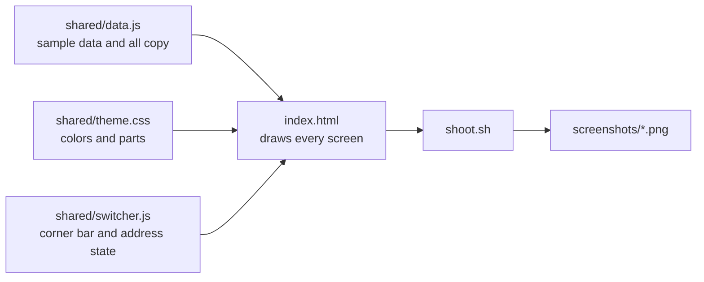

# Mockups

These are HTML mockups of the Waraq Android app, made to choose a layout before any screen is built. Every screen shows as a phone frame, 412 by 892 CSS pixels, in labelled rows. The documents in them are the made-up samples from `dev/fixtures`.

## Open the mockups

Open `index.html` in a browser. The bar in the top corner switches three things:

- **Direction A** or **Direction B**.
- **Light** or **Dark**.
- **Normal** or **Large** text. Large text sets the font scale to 1.3, to check that the layout holds.

The page keeps its state in the address, so a link opens the same view. For example, `index.html#direction=b&theme=dark&text=large` opens Direction B in dark mode with large text. Add `&clean=1` to hide the bar.

## The two directions

The two directions differ in two places. Every other screen is the same in both.

| | Direction A | Direction B |
|---|---|---|
| App shell | Three tabs at the bottom: Inbox, Documents, and Uploads with a count. A large Scan button floats above the tabs. Inbox is the start screen. | One home screen with search at the top and an **Inbox \| All** switch under it. A wide Scan button sits at the bottom. A slim strip under the search field shows uploads in progress and opens the Uploads screen. |
| Batch details (screen 8e) | One screen. A "For every document" section comes first, then one card per document. A shared value shows as "From the batch". | One document per page, with its pages at the top. Each field has a "Use for all documents" switch. |

The bottom of `index.html` says what each choice is good at and what it costs.

## Take screenshots

`shoot.sh` saves the whole page in one state as a PNG with headless Chrome:

```sh
./shoot.sh a light normal screenshots/a-light.png
```

The arguments are the direction (`a` or `b`), the theme (`light` or `dark`), the text size (`normal` or `large`), and the output file. Chrome keeps its profile in `.chrome-profile`, which git ignores.

## Files



`shared/data.js` holds every sample document and every word that shows on screen, so the screens hold no text of their own. The seed has no saved views, storage paths, custom fields, notes, or archive numbers yet, so `data.js` makes up a few of each.
